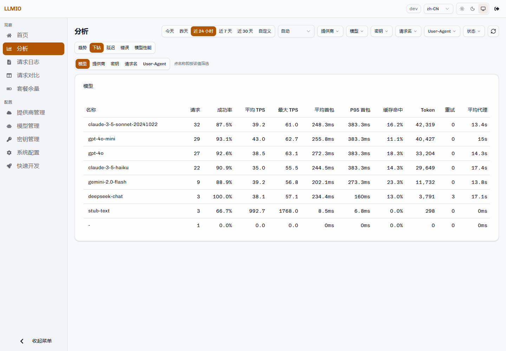
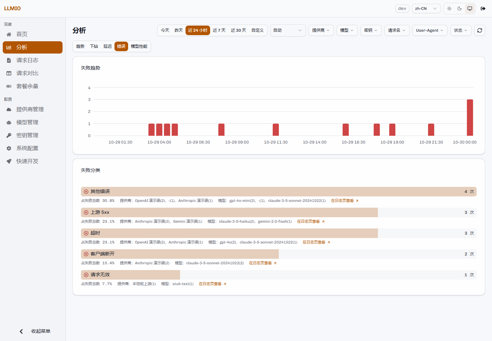
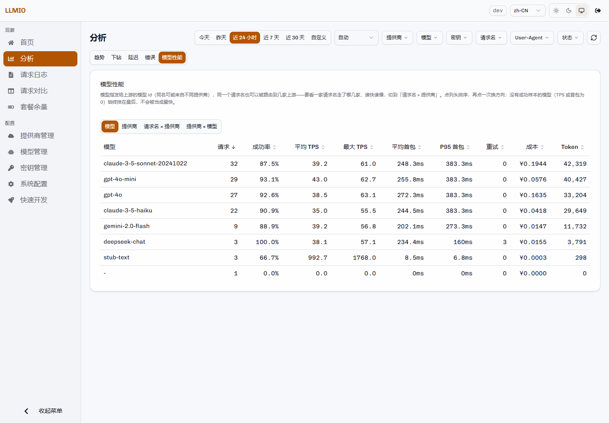

# 用量分析

「分析」页用同一份时间切片回答五类问题：请求量怎么变、Token 花在哪里、延迟如何分布、失败是什么原因、哪个模型或提供商更快。


## 时间范围与粒度

时间范围：

- 今天
- 昨天
- 近 24 小时
- 近 7 天
- 近 30 天
- 自定义起止时间

粒度：

```text
5m、15m、30m、1h、2h、6h、12h、1d、7d
```

`auto` 会按时间跨度选择首个使桶数不超过约 60 的档位。跨度极大时使用最大档位 `7d`。

分析接口一次返回整份切片，因此同一页面上的趋势、下钻、延迟与错误数字来自同一时间窗，不会因为多个请求各自取数而漂移。

## 指标口径

| 指标 | 口径 |
|---|---|
| 请求数 | 时间窗内的日志条数，包含成功、失败与在途。 |
| 成功率 | 成功 ÷（成功 + 失败）。在途请求不计入分母。 |
| Token | 输入 Token、输出 Token 与总计。 |
| 缓存命中率 | 缓存命中 Token ÷ 输入 Token。 |
| 重试次数 | 所有请求的 `Retry` 字段之和。 |
| 平均每请求重试次数 | 重试次数 ÷ 请求数。不是百分比。 |
| 平均 TPS | 成功请求的 TPS 平均值。 |
| 首包 P50 | 成功请求首包耗时的最近秩分位。 |
| 成本 | 非缓存输入 × 输入单价 + 缓存读 × 缓存单价 + 输出 × 输出单价，按每百万 Token 计。 |

TPS 的计算方式：

```text
输出 Token ÷ 请求开始到响应结束的总耗时（秒）
```

不是「输出 Token ÷ 首包之后的耗时」。因此首包很慢的请求 TPS 会被拉低。

### 分位数

分位数为最近秩（nearest-rank），不做线性插值：

```text
idx = floor((n - 1) × p)
```

小样本下 P90、P95、P99 可能取到同一个值。这是定义，不是缺陷。

### 成本

三档价格来自请求实际使用的关联，并在请求发生时写入日志。之后修改价格或删除关联不会改变历史成本。

没有填写价格的关联按 0 计算。分析结果使用一个币种作为展示单位，取自时间窗内首个非空币种。不同币种不会自动换算；如果同一时间窗混用多种币种，合计值没有比较意义。建议先用筛选条件限定到同一币种，再比较成本。

## 五个视图

### 趋势

展示请求趋势、Token 趋势与成本趋势。

- 请求趋势按成功、失败、在途堆叠。
- Token 趋势拆分为非缓存输入、缓存读、输出。
- 成本趋势按请求时的价格快照累计。

### 下钻

按模型、提供商、密钥、请求名、User-Agent 五个维度聚合。

- 点名称即按该值筛选，再点一次取消。
- 表格支持成功率、平均/最大 TPS、平均/P95 首包、缓存命中、Token、重试、平均代理耗时等列。
- 行数较多时只显示前若干项，其余在「还有 N 项未显示」中。



### 延迟

- 首包耗时分布：固定区间直方图，不同时间范围的图可以直接比较。
- P50 / P90 / P95 / P99 / 平均值 / 最大值。
- TPS 读数与代理耗时。
- TPS 榜首与最慢首包榜。

### 错误

失败按类别聚合，并展示受影响的提供商、模型与样本。



类别由错误文本判定：

| 类别 | 判定 |
|---|---|
| 请求无效 | 可解析出 400。 |
| 鉴权失败 | 可解析出 401。 |
| 余额不足 | 可解析出 402。 |
| 无权限 | 可解析出 403。 |
| 上游未找到 | 可解析出 404。 |
| 超时 | 408，或错误文本包含超时特征。 |
| 限流 | 可解析出 429。 |
| 上游 5xx | 500/502/503/504，或其他 5xx。 |
| 客户端断开 | 错误文本包含客户端取消特征。 |
| 上游业务错误 | 命中提供商配置的响应体错误样本。 |
| 重试耗尽 | 错误文本包含 `All retry failed`。 |
| 网络错误 | `dial tcp`、连接拒绝、连接重置、DNS、EOF 等。 |
| 其他错误 | 以上都不匹配。 |

判定顺序是：可解析的 HTTP 状态码 → 正文特征规则 → 其他。超时规则排在网络错误之前，客户端断开规则排在重试耗尽之前。

样本保留错误原文的前 500 个字符。点样本可以跳到日志页定位具体请求。

### 模型性能

提供四种维度：

| 维度 | 行代表 |
|---|---|
| 模型 | 上游模型 ID（`provider_model`）。 |
| 提供商 | 提供商名称。 |
| 请求名 × 提供商 | 一个请求名在一家提供商上的表现。 |
| 提供商 × 模型 | 一家提供商的某个上游模型。 |

注意「模型」维度使用的是实际发给上游的模型 ID，不是客户端的请求名。同名模型可能来自不同提供商；要区分请求名与提供商，切到「请求名 × 提供商」。

没有成功样本的行（TPS 或首包为 0）始终排在最后，不会被当成最快。



## 筛选

支持六个维度：

- 提供商
- 模型（上游模型 ID）
- 密钥
- 请求名
- User-Agent
- 状态

筛选项从同一时间窗单独取一次，不随已选筛选变化。分析页的筛选是精确匹配；要按名称的一部分搜索，请使用日志页的搜索框或调整时间范围。

筛选条件会同时作用于五个视图。切换视图不会改变当前切片。

## 明细上限

单次分析最多扫描 20 万条日志。达到上限时：

- 页面顶部显示截断提示。
- 数字可能不完整。
- 缩小时间范围或增加筛选条件可以得到准确值。

## 加载与取消

分析取数是单次长请求。页面提供：

- 已用时间。
- 取消按钮。
- 慢查询提示。
- 「先看近 24 小时」快捷入口。

性能参考：在 100m CPU / 128Mi 内存的 Sealos 实例上，约 7.8 万条日志的分析页加载约 22 秒。取数已改为流式，内存占用与窗口行数解耦，但延迟仍随扫描行数增长。需要频繁查看大窗口时，应分配更多 CPU，或缩小时间范围、增加筛选条件。

取消后不会用旧响应覆盖新结果。快速请求不会闪现长时加载提示。
