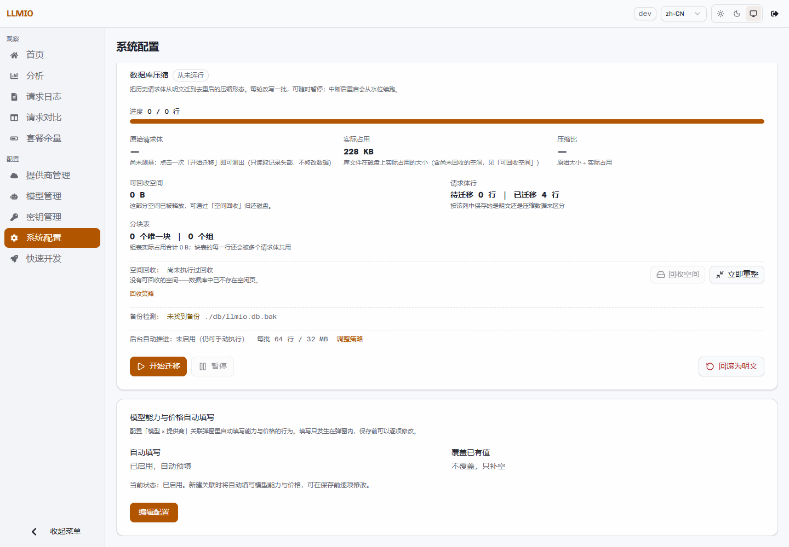

# 配置说明

LLMIO 的配置分三层：

| 层 | 位置 | 适用 |
|---|---|---|
| 环境变量 | 进程环境 | 部署参数，如端口、令牌、数据库路径。 |
| 系统配置 | SQLite `configs` 表 | 控制台可编辑的策略与连接信息。 |
| 配额配置 | `db/quota.config.json` | 余额与套餐数据源，单独存放。 |

本页说明环境变量、系统配置卡片和策略 JSON。

## 环境变量

| 变量 | 默认值 | 说明 |
|---|---|---|
| `TOKEN` | 空 | 控制台与 API 鉴权令牌。为空时不校验。公网部署必须设置。 |
| `GIN_MODE` | `debug` | 生产环境设为 `release`。 |
| `LLMIO_SERVER_PORT` | `7070` | 监听端口。 |
| `TZ` | 宿主机默认 | 影响日志时间、定时任务与峰谷计费。 |
| `DB_COMPRESS` | `true` | 新写入的请求正文是否压缩。 |
| `DB_VACUUM` | 不执行 | 启动时执行一次 `VACUUM`。 |
| `DB_AUTO_VACUUM_REBUILD` | `auto` | 是否把既有库转换为增量回收模式。 |
| `LLMIO_QUOTA_CONFIG` | `./db/quota.config.json` | 配额配置文件路径。 |
| `LLMIO_QUOTA_ALLOW_WRITE` | 允许 | 只有值为 `false` 时禁用配额写操作。 |
| `LLMIO_DB_PATH` | `./db/llmio.db` | 数据库文件路径。 |
| `PORT` | 空 | 平台注入端口；仅在未设置 `LLMIO_SERVER_PORT` 时使用。 |
| `LLMIO_DEMO_SEED` | 不启用 | 向空库写入演示数据。 |
| `VERCEL` | 空 | Vercel 平台标记，会启用演示数据与临时库路径。 |

详细部署说明见[部署](Deployment)。

## 系统配置页

「系统配置」页包含五张卡片。

### Anthropic 令牌计数配置

用于 `/anthropic/v1/messages/count_tokens`。这份配置独立于模型关联，Token 计数请求直接转发到这里的 Anthropic 地址。

| 字段 | 默认值 |
|---|---|
| Base URL | `https://api.anthropic.com/v1` |
| API Key | 空 |
| API Version | `2023-06-01` |

保存后可以点「检测配置」发送一次计数请求。未配置时，Token 计数端点返回 404。

### 日志定时清理

| 字段 | 默认值 |
|---|---|
| 启用自动清理 | 关闭 |
| 保留天数 | 30 |

后台每小时检查一次。启用后，超过保留天数的日志会被删除。手动清理与定时清理的历史可以在「查看清理历史」中查询。

### 峰谷工作日日历

配置时区、工作日定义、按日期覆盖与节假日同步。详见[峰谷计费](Peak-Billing)。

### 数据库压缩

配置迁移策略、回收策略，执行迁移、回滚、回收与重整。详见[数据库维护](Database-Maintenance)。

### 模型能力与价格自动填写

| 字段 | 默认值 | 说明 |
|---|---|---|
| 自动填写 | 开启 | 关闭后关联弹窗不再预填。 |
| 覆盖已有值 | 关闭 | 关闭时只补空值。 |
| 为已废弃模型提供建议 | 关闭 | 开启后，数据源标记为废弃的模型也会给出建议。 |
| 数据源 | `models.dev`、`litellm` | 按顺序尝试。 |

自动填写只发生在关联弹窗内，保存前可以逐项修改。保存路径不会在服务端补值。



## 策略配置键

这些配置保存在 SQLite 的 `configs` 表中，可通过通用配置接口读写。值是 JSON 字符串。

| 键 | 默认值 | 说明 |
|---|---|---|
| `log_cleanup_policy` | `{"enabled":false,"retention_days":30}` | 日志定时清理。 |
| `log_compress_policy` | `{"enabled":false,"batch_rows":64,"batch_bytes":33554432,"quiesce_sec":60,"batch_interval_ms":0}` | 数据库压缩迁移策略。 |
| `log_reclaim_policy` | `{"enabled":false,"min_bytes":268435456,"check_interval_sec":3600}` | 空间回收自动推进。 |
| `model_autofill_policy` | `{"enabled":true,"overwrite":false,"allow_deprecated":false,"sources":["models.dev","litellm"]}` | 模型能力与价格自动填写。 |
| `self_heal_policy` | `{"enabled":true,"max_drops":3}` | 上游点名参数时的删参自愈。 |
| `anthropic_count_tokens` | 无 | Anthropic Token 计数连接。 |
| `peak_calendar` | 默认日历 | 峰谷工作日日历。 |

压缩与回收的状态也保存在 `configs` 中，但它们是运行时状态，不建议手工修改：

- `log_compress_state`
- `log_decompress_state`
- `log_compress_backup`
- `log_reclaim_state`

### 自愈策略

`self_heal_policy` 没有控制台开关，只能通过配置接口修改：

```bash
curl -X PUT http://localhost:7070/api/config/self_heal_policy \
  -H "Authorization: Bearer <TOKEN>" \
  -H "Content-Type: application/json" \
  -d '{"value":"{\"enabled\":true,\"max_drops\":3}"}'
```

字段：

| 字段 | 说明 |
|---|---|
| `enabled` | 是否启用。默认 `true`。 |
| `max_drops` | 每家上游在一次请求中最多删除几个参数。`<=0` 时按 3 处理。 |

关闭后回到「上游点名参数即整次尝试失败」的行为。

### 自动填写策略

同样可以通过通用配置接口读写。数据源按数组顺序尝试，留空时使用默认值。

自动填写是纯前端预填，不改变保存逻辑。关闭后，已有表单值不受影响，新弹窗不再预填。

## 通用配置接口

### 读取

```bash
curl http://localhost:7070/api/config/log_cleanup_policy \
  -H "Authorization: Bearer <TOKEN>"
```

返回：

```json
{
  "code": 200,
  "message": "success",
  "data": {
    "key": "log_cleanup_policy",
    "value": "{\"enabled\":false,\"retention_days\":30}"
  }
}
```

配置不存在时返回 `value` 为空字符串，而不是 404。

### 写入

```bash
curl -X PUT http://localhost:7070/api/config/log_cleanup_policy \
  -H "Authorization: Bearer <TOKEN>" \
  -H "Content-Type: application/json" \
  -d '{"value":"{\"enabled\":true,\"retention_days\":14}"}'
```

`value` 必须是字符串，内容是目标配置的 JSON。写入不存在的键会创建一行。

管理接口的统一响应格式见[管理接口](Management-API#响应格式)。

## 配置的读取与生效

- 环境变量在启动时读取，修改后需要重启进程。
- 系统配置在保存后立即生效，部分策略会唤醒后台调度器。
- 工作日日历保存后，后续请求立即使用新日历。
- 关联、模型、提供商的修改在保存后对后续请求生效；历史日志保留请求时的快照。
- 配额配置保存在独立文件，保存后立即生效；只读模式下写接口返回 403。

## 配置丢失与恢复

- 数据库与配额配置都在 `./db` 目录，备份这个目录即可保留全部配置。
- 恢复时停止服务，替换 `db` 目录，再启动。
- 环境变量不在 `db` 目录中，需要单独保存部署配置。
- 不要把 `db` 目录提交到版本库，里面包含上游密钥与请求正文。
