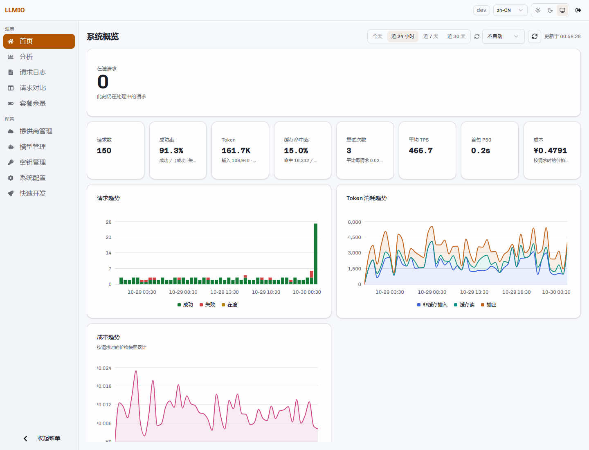
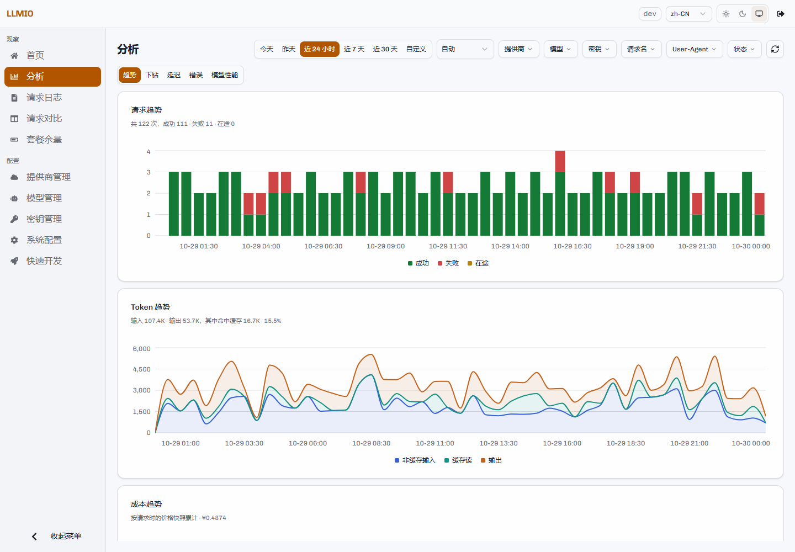
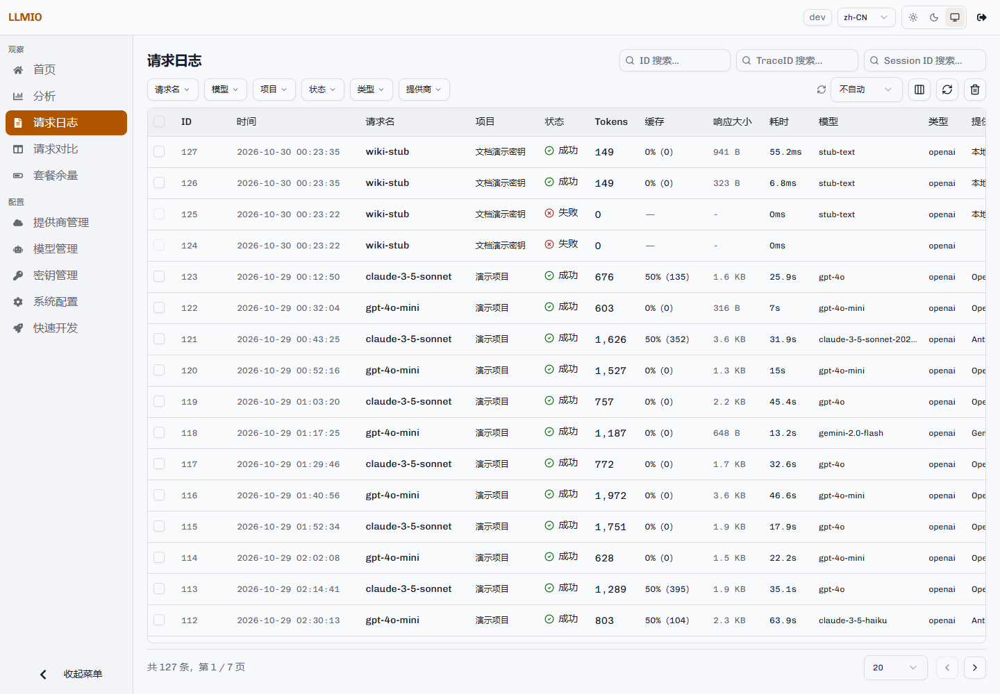
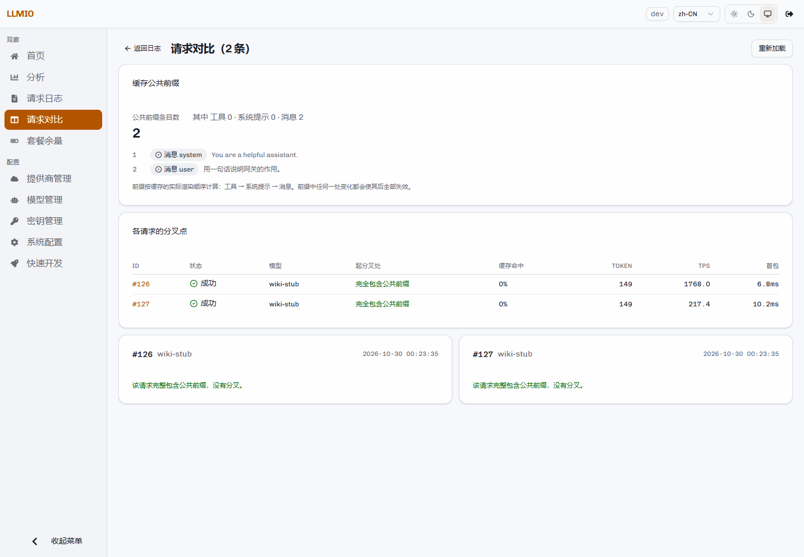
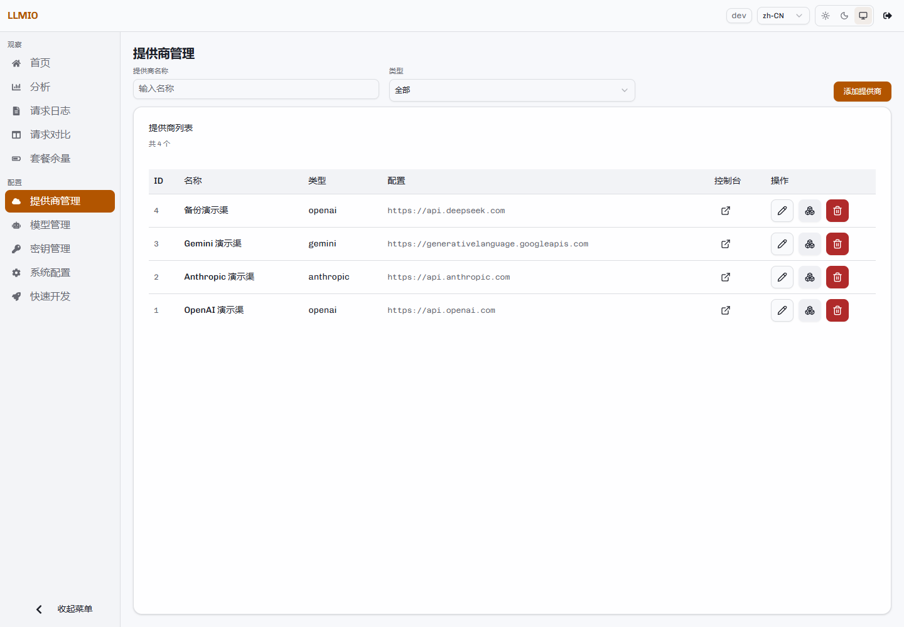
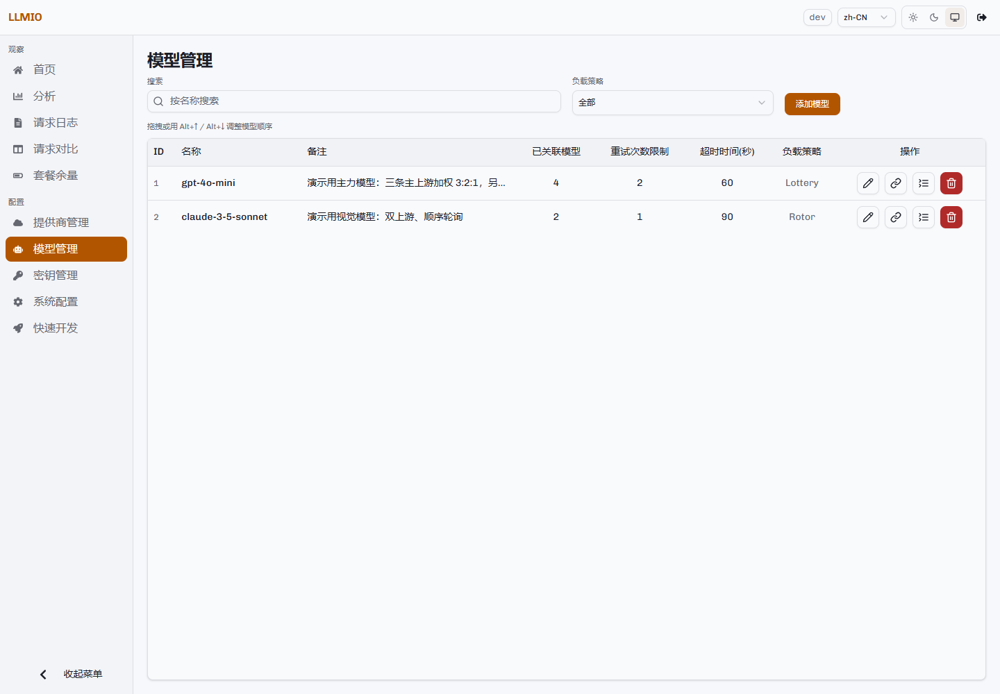
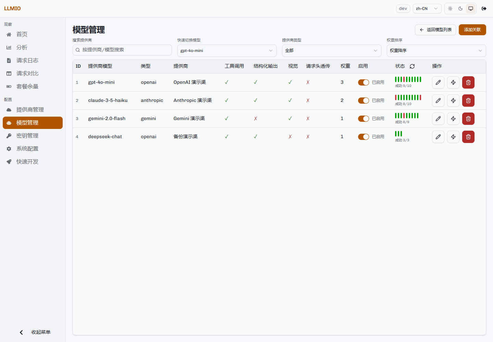
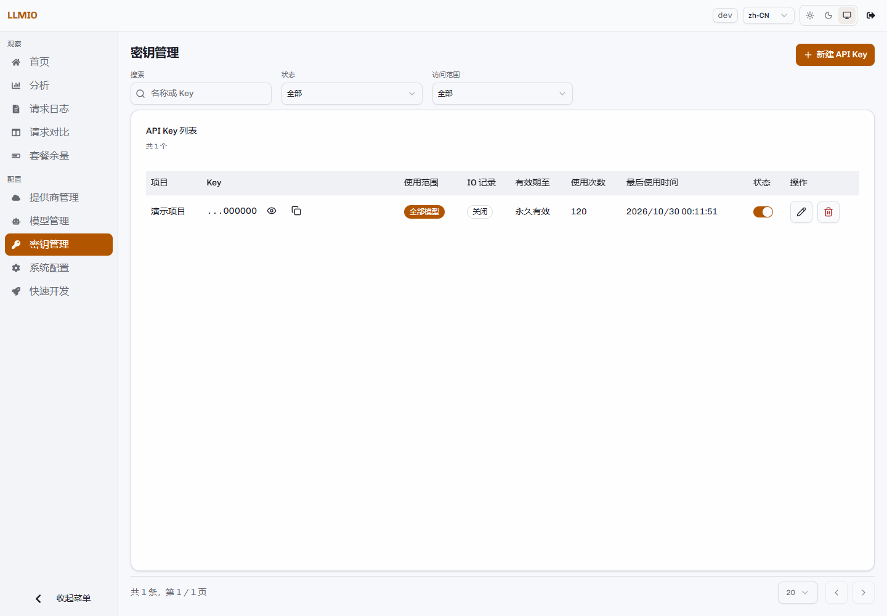
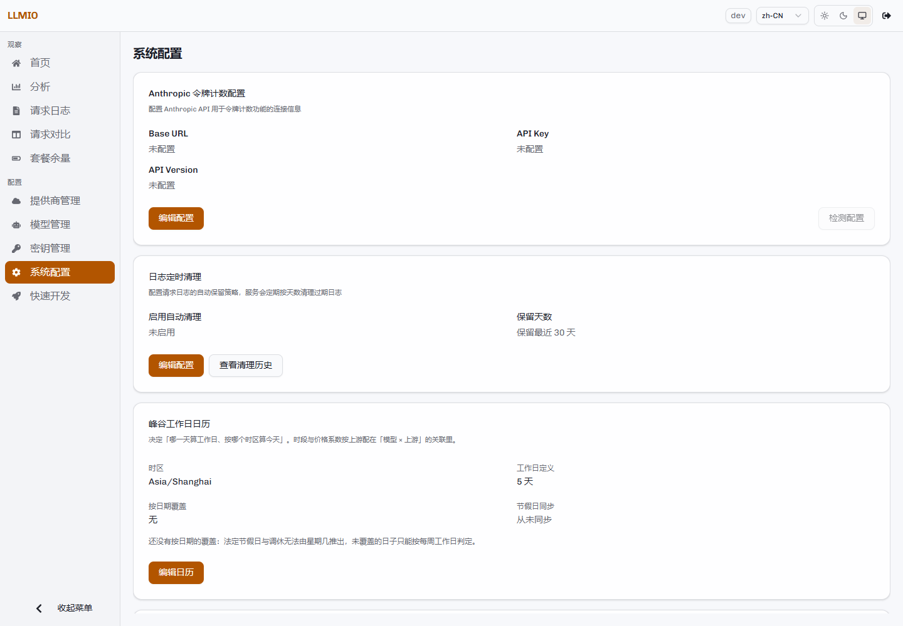
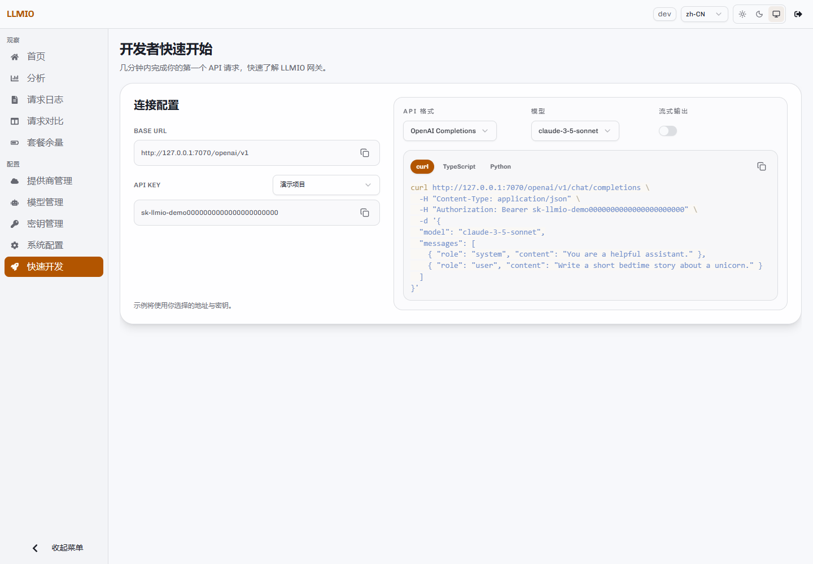

# 控制台指南

控制台与网关在同一个端口提供。登录后左侧是导航，右侧是页面内容。

导航分为三组：

- 观察：首页、分析、请求日志、请求对比、套餐余量。
- 配置：提供商管理、模型管理、密钥管理、系统配置。
- 快速开发：生成接入代码。

顶部可以切换界面语言、浅色/深色主题，查看当前版本，退出登录。

## 首页

首页展示所选时间范围内的运行情况。

- 在途请求：此刻仍在处理中的请求数。
- 请求数、成功率、Token、缓存命中率、重试次数、平均 TPS、首包 P50、成本。
- 请求趋势、Token 趋势、成本趋势。
- 首包耗时分布与 P50 / P90 / P95 / P99。
- 错误分类、按模型/提供商/密钥/客户端的分布、TPS 榜与最慢首包榜。

时间范围支持今天、近 24 小时、近 7 天、近 30 天与自定义。右上角可以设置自动刷新。

成本按请求发生时的价格快照累计。之后修改价格不会改变历史成本。

## 分析

「分析」页提供五个视图：趋势、下钻、延迟、错误、模型性能。支持时间范围、粒度与多维筛选。

详细口径见[用量分析](Analytics)。

## 请求日志

日志页按时间倒序列出请求记录。

可以按请求名、上游模型、项目、状态、类型、提供商、TraceID、Session ID、ID 筛选。列可以自定义显示或隐藏。

点击行尾的详情按钮打开侧边面板：

- 基本信息：请求名、提供商、模型、类型、响应大小、远端 IP、记录 IO、重试次数、User-Agent、TraceID、Session ID。
- 性能指标：代理耗时、首包耗时、完成耗时、TPS。
- Token 使用：输入、缓存、输出、总计。
- 计费：三档价格与总计。
- 协议转换：上游协议、转换方向与短码说明。

开启 IO 的请求可以点击「查看请求内容」，进入结构化展示页。

详细说明见[日志与对比](Logs-and-Compare)。

## 请求对比

在日志页勾选最多 6 条记录，点击「对比」进入对比页。

对比页展示：

- 公共前缀的条目数与构成（工具、系统提示、消息）。
- 每条请求的分叉点。
- 完整包含公共前缀的请求。
- 前缀分析只基于有请求内容的记录；未开启 IO 的记录会提示缺失。

前缀按缓存的实际渲染顺序计算：工具 → 系统提示 → 消息。前缀中任何一处变化都会使后面的内容无法复用缓存。这个页面适合分析「为什么缓存没有命中」。

## 套餐余量

「套餐余量」页展示各数据源的余额或套餐使用情况。

- 顶部摘要显示最紧张的一条、数据源正常数量与条目总数。
- 每个数据源一张卡片，显示条目、进度、状态、延迟与重置时间。
- 图表样式支持进度条、用量环、条形对比、纯文字。
- 卡片可以单独刷新、编辑数据源、设置展示名称与格式。
- 自动刷新档位为 0–600 秒，默认关闭。页面不可见时不会请求上游。

详细配置见[套餐余量](Quota)。

## 提供商管理

列表显示 ID、名称、类型、配置摘要、控制台链接与操作。

- 「添加提供商」创建新的上游。
- 铅笔按钮编辑配置。
- 节点按钮查看该提供商返回的模型列表。
- 删除提供商时，会同时删除它下面的关联。
- 控制台按钮打开配置里的上游用量页面。

字段说明见[提供商与模型](Providers-and-Models)。

## 模型管理

模型列表显示请求名、备注、关联数量、重试次数、超时时间、负载策略与操作。

- 拖拽行，或使用 `Alt+↑` / `Alt+↓` 调整模型顺序。
- 筛选状态下不能调整顺序，需要先清空筛选。
- 「添加模型」创建新的请求名。
- 搜索图标进入该模型的关联页。
- 关联页可以添加、编辑、停用、删除关联，并运行连通性或 React Agent 测试。

关联页顶部可以按提供商/模型搜索、快速切换模型、按提供商类型筛选、按权重排序。

## 密钥管理

列表显示项目、Key（默认隐藏）、使用范围、IO 记录、有效期、使用次数、最后使用时间与状态。

- 新建时设置项目名称、是否记录 IO、模型权限、有效期。
- 眼睛按钮显示或隐藏 Key，复制按钮复制 Key。
- 开关切换启用状态，关闭后该 Key 立即失效。
- 删除后不可恢复。
- 使用次数与最后使用时间由网关异步更新。

## 系统配置

系统配置由多张卡片组成：

| 卡片 | 作用 |
|---|---|
| Anthropic 令牌计数配置 | Token 计数端点使用的 Anthropic 连接。 |
| 日志定时清理 | 保留天数、定时清理开关、清理历史。 |
| 峰谷工作日日历 | 时区、工作日定义、按日期覆盖、节假日同步。 |
| 数据库压缩 | 迁移进度、压缩比、空间回收、重整。 |
| 模型能力与价格自动填写 | 关联弹窗的预填开关、覆盖策略与数据源。 |

每张卡片的操作与代价都在确认弹窗中说明。涉及数据库写入的操作会明确写出对读写请求的影响。

## 快速开发

选择 API 格式、模型、API Key、是否流式，页面会生成 curl、TypeScript 或 Python 示例。Base URL 自动使用当前控制台地址。

这个页面适合确认「地址、模型名、密钥」三件事是否一致。

## 显示与主题

- 界面语言：简体中文、繁體中文、English。
- 主题：浅色、深色、跟随系统。
- 菜单：左下角按钮可以收起或展开侧边栏。
- 版本：顶部版本按钮显示当前版本号。

主题与语言保存在浏览器本地，不影响服务端配置。
