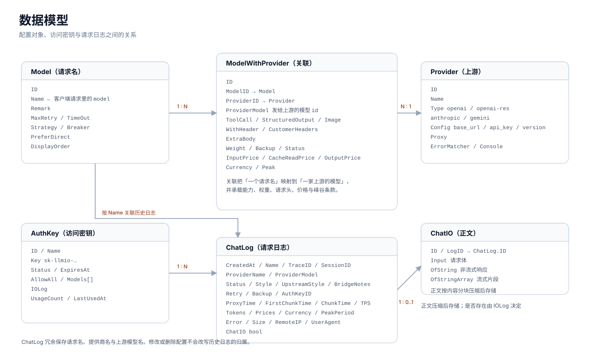
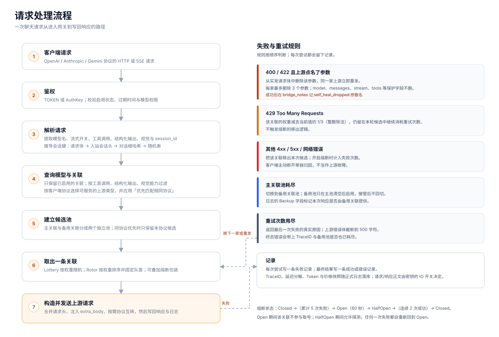

# 核心概念

LLMIO 的配置由四个对象组成：提供商、模型、模型与提供商的关联、访问密钥。请求日志和请求正文是运行结果，不是配置。

## 提供商 Provider

提供商表示一个上游服务及其连接信息。

| 字段 | 作用 |
|---|---|
| 名称 | 展示用名称，需要唯一。 |
| 类型 | 决定使用哪个适配器，以及请求路径和鉴权头。可选 `openai`、`openai-res`、`anthropic`、`gemini`。 |
| 配置 | 包含 `base_url`、`api_key`，Anthropic 还包含 `version`。 |
| HTTP 代理 | 可选的出口代理。 |
| 响应体错误识别 | 一串样本。返回 HTTP 200 但响应体命中样本时，按失败处理。 |
| 控制台地址 | 上游账单或用量页面的链接。 |

提供商本身不参与调度，也不会出现在客户端的模型列表里。它必须通过关联映射到某个模型。

## 模型 Model

模型表示客户端请求时使用的名称，也就是请求体中的 `model` 字段。LLMIO 不要求这个名称与上游模型 ID 相同。

模型上还有调度参数：

| 字段 | 作用 |
|---|---|
| 重试次数限制 | 一次请求最多尝试多少次，包含第一次。 |
| 超时时间 | 一次请求的总时间预算，单位为秒。流式请求等待响应头的时间为该值的三分之一。 |
| 负载均衡策略 | `Lottery` 按权重随机；`Rotor` 按权重排序并固定使用队首。 |
| 熔断 | 是否为该模型的关联启用熔断包装。 |
| 优先匹配相同协议 | 默认开启。优先选择与客户端同协议的提供商；没有同协议提供商时才使用可互转的协议。 |
| 展示顺序 | 控制台模型列表的排序。 |

模型不直接保存上游地址或密钥。这些信息在关联上。

## 关联 ModelWithProvider

关联把「一个请求名」映射到「一家提供商的某个模型」。一个模型可以有多个关联，因此一个请求名可以对应多家上游。

关联决定：

- 实际发给上游的模型 ID（提供商模型）。
- 这条上游是否支持工具调用、结构化输出、视觉。
- 权重，以及在主池还是备用池。
- 是否透传客户端请求头，以及自定义请求头。
- 是否注入额外的请求体参数。
- 输入、缓存读、输出三档单价与币种。
- 这条关联自己的峰谷计费条款。
- 是否启用。

只有启用且能力匹配的关联才会进入本次请求的候选池。

## 访问密钥 AuthKey

访问密钥用于区分调用方。格式为 `sk-llmio-` 加 36 个字符。

密钥可以设置：

- 启用或停用。
- 过期时间。
- 允许全部模型，或只允许指定模型。
- 是否记录 IO。关闭时不保存请求体和响应体，但日志的元数据仍会记录。

`TOKEN` 是管理员令牌，拥有全部模型权限，不受 AuthKey 的模型限制。公网部署时不要把它分发给普通调用方。

## 请求日志 ChatLog

每次请求最终会产生一条 `ChatLog`。它记录请求名、提供商标识、上游模型、客户端协议、上游协议、状态、重试次数、是否由备用关联接管、TraceID、Session ID、耗时分解、Token 用量、价格快照与费用。

日志里的提供商名和模型名是请求时的字符串快照。之后修改或删除配置不会改写历史日志。

## 请求正文 ChatIO

当调用方使用的 AuthKey 开启「记录 IO」时，LLMIO 会额外保存请求体和响应体：

- `Input`：请求体。
- `OfString`：非流式响应。
- `OfStringArray`：流式响应片段。

正文按内容分块压缩后存储，读取接口会透明还原。正文是否存在由密钥的 IO 开关决定，而不是由日志本身决定。

## 请求生命周期

一次请求依次经过：

1. 鉴权：校验令牌、启用状态、过期时间与模型权限。
2. 解析：读取模型名、流式开关、能力标记与会话信息。
3. 查关联：只保留启用且能力匹配的关联。
4. 建候选池：按客户端协议与「优先匹配相同协议」筛选；主关联与备用关联分开。
5. 调度：按策略取出一条关联。
6. 构造上游请求：合并请求头、注入 `extra_body`、必要时做协议互转。
7. 发送并处理响应：成功则记录日志并返回；失败则按规则重试、降权、换家或自愈。
8. 写日志：成功或最终失败写入正式日志，请求正文按 IO 开关写入。

详细规则见[调度与可靠性](Routing-and-Reliability)。

## 配置的生效范围

| 对象 | 生效范围 |
|---|---|
| 提供商配置 | 所有引用它的关联。 |
| 模型参数 | 该请求名下的所有关联。 |
| 关联配置 | 只影响这一条上游映射。 |
| AuthKey | 只影响使用该 Key 的请求。 |
| 工作日日历 | 全局，影响所有峰谷计费条款。 |
| 日志保留、压缩、回收策略 | 全局。 |
| 配额数据源 | 全局，配置保存在 `quota.config.json`。 |

## 删除行为

- 删除提供商时，LLMIO 会同时删除该提供商下的关联。
- 删除模型时，不会自动删除该模型下的关联。删除模型前，建议先进入关联页清理，或确认这些关联不再需要。
- 删除关联后，该上游不再参与调度。
- 删除 AuthKey 后，使用该 Key 的请求立即失效。
- 删除日志不会删除配置；日志清理只影响历史记录。

## 请求名与上游模型名

这两个名称经常被混淆：

- 请求名是客户端在 `model` 字段里发送的值，对应「模型管理」中的名称。
- 上游模型名是 LLMIO 实际发给提供商的 `model` 值，对应关联里的「提供商模型」。

例如客户端发送 `gpt-4o-mini`，LLMIO 可以把它映射到上游的 `gpt-4o-mini-2024-07-18`。客户端不需要知道上游的真实模型 ID。

同一个请求名也可以关联不同协议的提供商。开启「优先匹配相同协议」时，LLMIO 优先选择说客户端协议的提供商；关闭后，所有可服务的提供商一起按权重参与。
