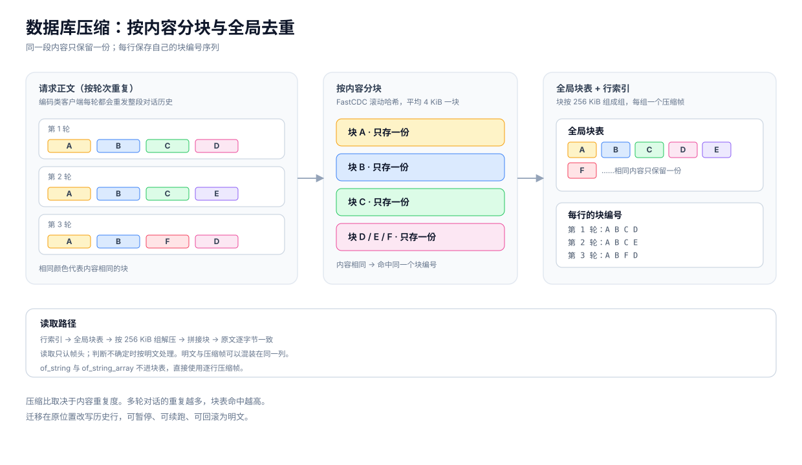
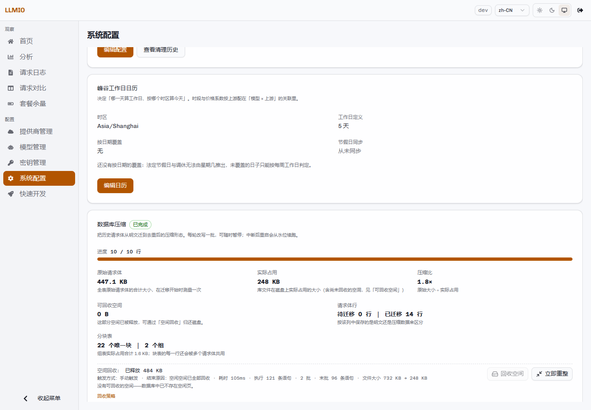

# 数据库维护

LLMIO 使用 SQLite，数据文件默认在 `./db/llmio.db`。配置、日志和请求正文都在这个文件里。

请求日志的体积主要来自三列正文：

- `chat_ios.input`：请求体。
- `chat_ios.of_string`：非流式响应。
- `chat_ios.of_string_array`：流式响应片段。

多轮对话会反复发送历史内容。同一段内容在多个请求中重复出现，因此按内容分块并全局去重可以显著减少占用。



## 压缩的组成

| 部分 | 作用 |
|---|---|
| 内容分块 | 请求体按内容边界切成平均 4 KiB 的块。 |
| 全局块表 | 内容相同的块只保存一份。 |
| 块组 | 块按 256 KiB 组成组，每组一个压缩帧。 |
| 组缓存 | 读取时在内存中保留 32 MiB 的组缓存。 |
| 逐行帧 | `of_string` 与 `of_string_array` 不进块表，直接使用逐行压缩帧。 |

读取时按块编号拼回原文。帧有自描述头，明文与压缩帧可以混装在同一列；读取只认帧头，判断不确定时按明文处理。

## 迁移历史正文

新写入的行在 `DB_COMPRESS=true`（默认）时直接以压缩形态落库。历史行可以在原位置改写。

迁移特性：

- 按批提交，默认每批 64 行 / 32 MiB。
- 可随时暂停；当前批次执行完成后停止。
- 中断后重启会从水位继续，已迁移的部分不会重复处理。
- 迁移期间读取不受影响；写入请求最多等待一批的时间。
- 默认不处理最近 60 秒内写入过的行，避免读到尚未写完的数据。
- 迁移完成后，压缩比与分块表读数会更新。

### 备份要求

迁移会原地改写历史行。开始前建议复制一份数据库文件。

控制台会自动探测：

```text
./db/llmio.db.bak
```

探测结果：

| 状态 | 含义 |
|---|---|
| 已找到可用备份 | 备份存在，且不小于当前数据库。 |
| 备份小于当前数据库 | 可能是迁移前的旧备份，用它还原会丢数据。 |
| 未找到备份 | 路径上没有文件。 |

没有可用备份时，控制台要求明确确认后才执行，并在记录中标注「无备份」。

### 回滚

「回滚为明文」会把所有压缩正文还原为明文。

- 数据库文件会明显变大。
- 迁移进度会被重置。
- 回滚后再次迁移需要重新完整执行一遍。
- 回滚不会自动缩小文件，需要空间回收或重整。

## 空间回收

SQLite 删除行只是把页放回空闲列表。默认配置下，文件不会自动缩小。

两条路：

| 方式 | 前提 | 特点 |
|---|---|---|
| 增量回收 | 数据库的 `auto_vacuum` 为 `INCREMENTAL`（值 2）。 | 在线执行，不需要额外磁盘；较慢；可中断、可重复。 |
| 整库重整（VACUUM） | 不需要特定 `auto_vacuum`。 | 一次还干净；需要 2 倍库大小的空闲磁盘；全程独占。 |

### 增量回收

- 只在 `auto_vacuum=2` 的库上有效。
- 新库在建表前自动设为 `INCREMENTAL`。
- 既有库默认不修改。需要转换时设置 `DB_AUTO_VACUUM_REBUILD=on`，服务会在监听端口前执行一次 `VACUUM`。
- 转换期间独占写入，需要约 2 倍库大小的空闲磁盘。磁盘不足时跳过并记录原因，不影响启动。
- 回收逐个空闲页归还文件系统。
- 批量从 64 条起，在 16–512 之间按上一批的实测耗时自适应，目标每批约 2.5 秒。
- 单轮最长 90 秒，未完成的部分留待下一轮。
- 持续模式在批与批之间暂停 0.1 秒，写入请求会排队但通常不会失败。
- 回收不修改数据，可以重复执行，也可以中断。

### 整库重整

- 把整个数据库重写一遍，一次归还所有空闲页。
- 需要约 2 倍库大小的空闲磁盘。
- 全程独占：读与写都进不来，写入请求会失败。
- 一旦开始无法中途停止。
- 适合迁移、回滚、批量删除之后的大空洞。

### 如何选择

- 空闲空间很大：用 VACUUM，一次完成，但需要离线窗口与额外磁盘。
- 日常产生的小空洞：用增量回收，在线，不需要额外磁盘，但要先完成 `auto_vacuum` 转换。

## 控制台操作

「系统配置」→「数据库压缩」卡片提供：



- 迁移状态、进度、压缩比、原始大小、实际占用、可回收空间。
- 「开始迁移」「暂停」「回滚为明文」。
- 「回收空间」「立即重整」。
- 「调整策略」：是否后台自动推进、每批行数、每批字节数、批间暂停、冷静期。
- 「回收策略」：是否后台自动回收、可回收空间门槛、检查周期。
- 备份探测结果。

两个回收入口在确认前会说明代价：回收是写入排队变慢；重整是读写都进不来、写入会失败。

## 管理接口

| 路径 | 方法 | 功能 |
|---|---|---|
| `/api/logs/compression` | GET | 迁移状态、策略、数据库现状、回收结果、当前维护任务。 |
| `/api/logs/compression/policy` | PUT | 设置迁移策略。 |
| `/api/logs/compression/run` | POST | 开始迁移。 |
| `/api/logs/compression/pause` | POST | 请求暂停，当前批次完成后生效。 |
| `/api/logs/compression/decompress` | GET | 查询回滚进度。 |
| `/api/logs/compression/decompress` | POST | 回滚为明文。请求体需要 `full=true` 与 `confirm="decompress"`。 |
| `/api/logs/compression/reclaim` | POST | 回收空间。`continuous=true` 持续到完成；空请求体为单轮。 |
| `/api/logs/compression/reclaim/stop` | POST | 停止持续回收，当前批次完成后生效。 |
| `/api/logs/compression/reclaim/policy` | PUT | 设置回收策略。 |
| `/api/logs/compression/vacuum` | POST | 后台整库重整。 |

开始迁移时，如果没有可用备份，需要显式确认：

```bash
curl -X POST http://localhost:7070/api/logs/compression/run \
  -H "Authorization: Bearer <TOKEN>" \
  -H "Content-Type: application/json" \
  -d '{"acknowledge_no_backup": true}'
```

回滚：

```bash
curl -X POST http://localhost:7070/api/logs/compression/decompress \
  -H "Authorization: Bearer <TOKEN>" \
  -H "Content-Type: application/json" \
  -d '{"full": true, "confirm": "decompress"}'
```

参数越界会被收敛到允许区间，而不是报错：

| 参数 | 范围 | 越界处理 |
|---|---|---|
| 每批行数 `batch_rows` | 1–4096 | 小于 1 回默认 64，大于 4096 取 4096。 |
| 每批字节数 `batch_bytes` | 不超过 1 GiB | 小于 1 回默认 32 MiB，超过取 1 GiB。 |
| 批间暂停 `batch_interval_ms` | 0–5000 毫秒 | 负值取 0。 |
| 冷静期 `quiesce_sec` | 0–86400 秒 | 负值取 0。 |
| 可回收空间门槛 `min_bytes` | 0–1 TiB | 负值取 0。 |
| 检查周期 `check_interval_sec` | 60–86400 秒 | 小于 60 取 60。 |

## 维护期间的互斥

- 迁移与回收共用同一个维护锁，不会同时进行。
- 日志定时清理在迁移或回收期间跳过本轮。
- 重整要求没有其他维护任务在运行。
- 迁移或回收进行时，状态接口可能短暂读取不到数据库读数，页面会提示并自动重试。

## 注意事项

1. 压缩后的正文列不能直接用于 SQL 文本比较。针对正文的 `LIKE`、`json_extract` 等查询会失效。读取单条正文请使用 `/api/logs/:id/chat-io`，接口会透明还原。
2. `DB_COMPRESS=false` 只停止新写入行的压缩，历史压缩行仍可正常读取。
3. 迁移前确认存在可用备份。备份文件不要命名为 `llmio.db.bak` 以外的名字，否则控制台不会识别。
4. 回收不改变数据；重整也不改变数据，但会重写整库。
5. 数据库文件变大不等于数据变多。删除日志后需要回收或重整才能缩小文件。
6. 迁移、回滚与重整都是后台任务，接口返回 `started` 后需要轮询状态。
7. 同一时间只运行一个实例。SQLite 只有一个写入者，多副本共享同一目录会互相阻塞。

## 实测记录

在本地测试库上执行过一次完整流程：

- 写入 10 条明文请求正文，合计约 447 KiB。
- 迁移后 `input` 列从约 447 KiB 降到约 280 B；块表有 22 个唯一块、2 个组，组表约 1.6 KiB。
- 页面显示的约 1.8 倍是「原始正文总量 ÷ 数据库实际占用」，不是单列压缩比。
- 增量回收释放 121 个空闲页，文件从约 732 KiB 降到约 248 KiB。

这组数字只说明流程可用，压缩比取决于内容重复度，不能作为容量规划依据。
