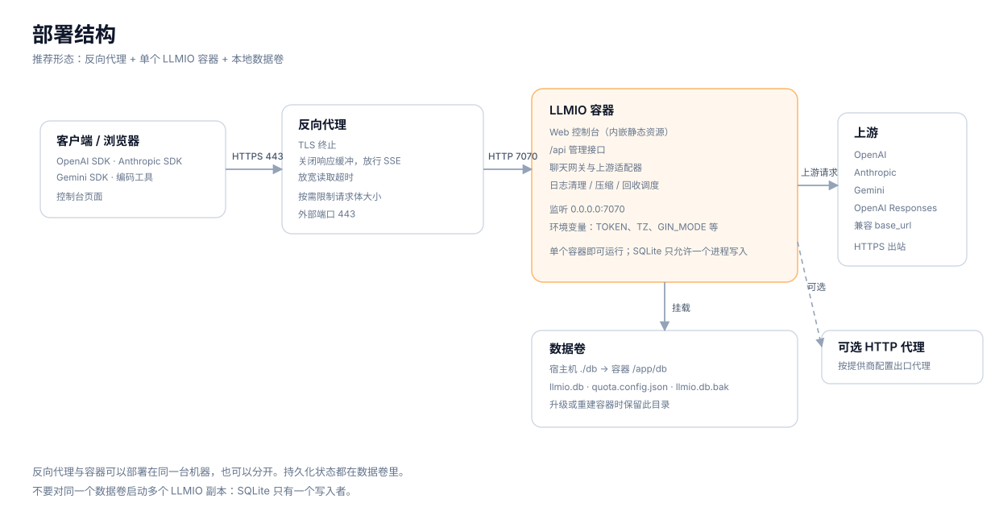

# 部署

LLMIO 是一个单二进制服务。控制台前端已经编译进二进制，启动后同时提供页面、聊天 API 和管理 API。数据保存在本地 SQLite 文件中。



## 部署方式

| 方式 | 适用场景 |
|---|---|
| Docker Compose | 推荐。升级、挂载卷和环境变量都清晰。 |
| Docker | 单容器运行，参数直接写在命令行。 |
| 发布包 | 不使用 Docker，直接运行 Linux / Windows / macOS 二进制。 |
| 源码构建 | 需要修改代码或使用 `master` 最新提交。 |

## Docker Compose

创建目录：

```bash
mkdir -p llmio && cd llmio
```

创建 `docker-compose.yml`：

```yaml
services:
  llmio:
    image: atopos31/llmio:latest
    container_name: llmio
    ports:
      - "7070:7070"
    volumes:
      - ./db:/app/db
    environment:
      - GIN_MODE=release
      - TOKEN=<TOKEN>
      - TZ=Asia/Shanghai
    restart: unless-stopped
```

启动并检查：

```bash
docker compose up -d
docker compose ps
curl -H "Authorization: Bearer <TOKEN>" http://localhost:7070/api/version
```

升级：

```bash
docker compose pull
docker compose up -d
```

容器重建不会删除 `./db`。升级前建议先停止容器并复制这个目录。

## Docker

```bash
docker run -d \
  --name llmio \
  -p 7070:7070 \
  -v "$(pwd)/db:/app/db" \
  -e GIN_MODE=release \
  -e TOKEN=<TOKEN> \
  -e TZ=Asia/Shanghai \
  --restart unless-stopped \
  atopos31/llmio:latest
```

## 发布包

从 [Releases](https://github.com/atopos31/llmio/releases) 下载对应平台的压缩包。以 Linux amd64 为例：

```bash
wget https://github.com/atopos31/llmio/releases/download/v0.10.3/llmio_0.10.3_linux_amd64.tar.gz
tar -xzf llmio_0.10.3_linux_amd64.tar.gz
GIN_MODE=release TOKEN=<TOKEN> ./llmio
```

程序会在当前目录创建 `./db/llmio.db`。请让运行用户对 `./db` 有读写权限。

## 从源码构建

要求：

- Go 1.26.6 或兼容版本（以 `go.mod` 为准）。
- Node.js 20 与 pnpm（仅构建前端时需要）。

构建前端资源：

```bash
cd webui
pnpm install
pnpm run build
cd ..
```

构建二进制：

```bash
go build -o llmio .
```

或者使用项目提供的目标：

```bash
make webui   # 构建前端
go build -o llmio .
```

启动：

```bash
TOKEN=<TOKEN> GIN_MODE=release ./llmio
```

## 环境变量

| 变量 | 说明 | 默认值 | 备注 |
|---|---|---|---|
| `TOKEN` | 控制台登录与 API 鉴权令牌 | 空 | 公网部署必须设置。为空时管理接口和聊天接口不校验令牌。 |
| `GIN_MODE` | Gin 运行模式 | `debug` | 生产环境设为 `release`。 |
| `LLMIO_SERVER_PORT` | 服务监听端口 | `7070` | 只改监听端口，不改变容器映射。 |
| `TZ` | 时区 | 宿主机默认 | 影响日志时间、定时清理与峰谷计费的工作日判定。容器中建议显式设置。 |
| `DB_COMPRESS` | 新写入的请求正文是否压缩存储 | `true` | 设为 `false` 只影响新写入的行，历史压缩行仍可读。 |
| `DB_VACUUM` | 启动时执行一次 SQLite `VACUUM` | 不执行 | 设为 `true` 启用。需要独占写入与约 2 倍库大小的空闲磁盘。 |
| `DB_AUTO_VACUUM_REBUILD` | 既有库是否在启动时转换为增量回收模式 | `auto` | `auto` 只对空库设置；`on` 对既有库执行一次 `VACUUM` 完成转换；`off` 不修改。 |
| `LLMIO_QUOTA_CONFIG` | 配额配置文件路径 | `./db/quota.config.json` | 文件内容由控制台读写，不落数据库。 |
| `LLMIO_QUOTA_ALLOW_WRITE` | 是否允许配额写操作 | 允许 | 只有值为 `false`（区分大小写）时进入只读模式。 |
| `LLMIO_DB_PATH` | 数据库文件路径 | `./db/llmio.db` | 用于把数据库放到指定位置。 |
| `PORT` | 平台注入的监听端口 | 空 | 仅在未设置 `LLMIO_SERVER_PORT` 时使用。 |
| `LLMIO_DEMO_SEED` | 启动时灌入演示数据 | 不启用 | 只用于展示环境。会往空库写入演示提供商、模型与日志。 |
| `VERCEL` | Vercel 平台标记 | 空 | 平台自带。会启用演示数据与临时数据库路径。 |

关于压缩与回收的完整操作见[数据库维护](Database-Maintenance)。关于配置接口与策略键见[配置说明](Configuration)。

## 反向代理

LLMIO 自身只监听 HTTP，不处理 TLS。公网部署时在前面放 Nginx、Caddy 或云负载均衡。

Nginx 示例：

```nginx
server {
    listen 443 ssl http2;
    server_name llmio.example.com;

    ssl_certificate     /etc/letsencrypt/live/llmio.example.com/fullchain.pem;
    ssl_certificate_key /etc/letsencrypt/live/llmio.example.com/privkey.pem;

    client_max_body_size 100m;

    location / {
        proxy_pass http://127.0.0.1:7070;
        proxy_http_version 1.1;
        proxy_set_header Host $host;
        proxy_set_header X-Real-IP $remote_addr;
        proxy_set_header X-Forwarded-For $proxy_add_x_forwarded_for;

        # 流式响应必须关闭缓冲
        proxy_buffering off;
        proxy_cache off;

        # 大于模型配置的超时时间
        proxy_read_timeout 3600s;
        proxy_send_timeout 3600s;
    }
}
```

要点：

- 关闭 `proxy_buffering`，否则 SSE 会被代理攒起来，客户端看不到逐字输出。
- `proxy_read_timeout` 要大于模型的超时时间。
- 如果客户端会发送大请求体，调大 `client_max_body_size`。
- 不需要 WebSocket 配置。
- 如果使用 Cloudflare 等 CDN，确认其没有缓冲 `text/event-stream`。

Caddy 示例：

```caddy
llmio.example.com {
    reverse_proxy 127.0.0.1:7070 {
        flush_interval -1
    }
}
```

`flush_interval -1` 让 Caddy 立即转发流式响应。

## 数据、备份与恢复

所有持久化状态在 `./db` 目录：

| 文件 | 内容 |
|---|---|
| `llmio.db` | 提供商、模型、关联、密钥、配置、请求日志、请求正文。 |
| `llmio.db.bak` | 数据库压缩迁移前的备份（如果按约定放置）。 |
| `quota.config.json` | 配额与余量数据源配置，包含凭据。 |

备份步骤：

```bash
docker compose stop
cp -a db "db-backup-$(date +%Y%m%d-%H%M%S)"
docker compose start
```

先停止容器再复制，避免复制到写入中的数据库文件。恢复时停止容器，用备份目录替换 `db`，再启动。

`llmio.db.bak` 这个文件名有特殊含义：数据库压缩页面会自动探测它，并在迁移前检查它是否不小于当前数据库。不要把其他备份随意命名为这个文件。

## 资源与容量

- CPU 与内存：服务已在 100m CPU / 128Mi 内存的容器中启动并处理请求（Sealos 环境实测）。这是可运行的最低配置参考，不是性能承诺。
- 分析页：加载大量日志主要消耗 CPU 与磁盘 I/O。同一环境下，约 7.8 万条日志的分析页约需 22 秒。需要频繁查看大窗口时，应分配更多 CPU。
- 磁盘：主要由请求日志和请求正文占用。开启 IO 记录后，正文会显著增加占用。
- 数据库：SQLite 单写入者。不要对同一个 `db` 目录启动多个 LLMIO 实例。
- 文件句柄：大量并发流式请求会占用连接，按需调整容器的 `nofile` 限制。
- 日志保留：在控制台「系统配置」中设置保留天数与定时清理，避免磁盘无限增长。

## 安全建议

1. 设置足够长的随机 `TOKEN`，不要使用示例值。
2. 不要把 `7070` 直接暴露到公网；通过反向代理提供 TLS。
3. 为不同客户端创建独立的 AuthKey，按模型限制权限，并设置有效期。
4. 定期轮换 `TOKEN` 与上游 API Key。
5. 保护 `./db` 目录：数据库和配额配置中包含上游凭据。
6. 不需要 IO 记录时保持关闭，减少敏感请求正文的落盘。
