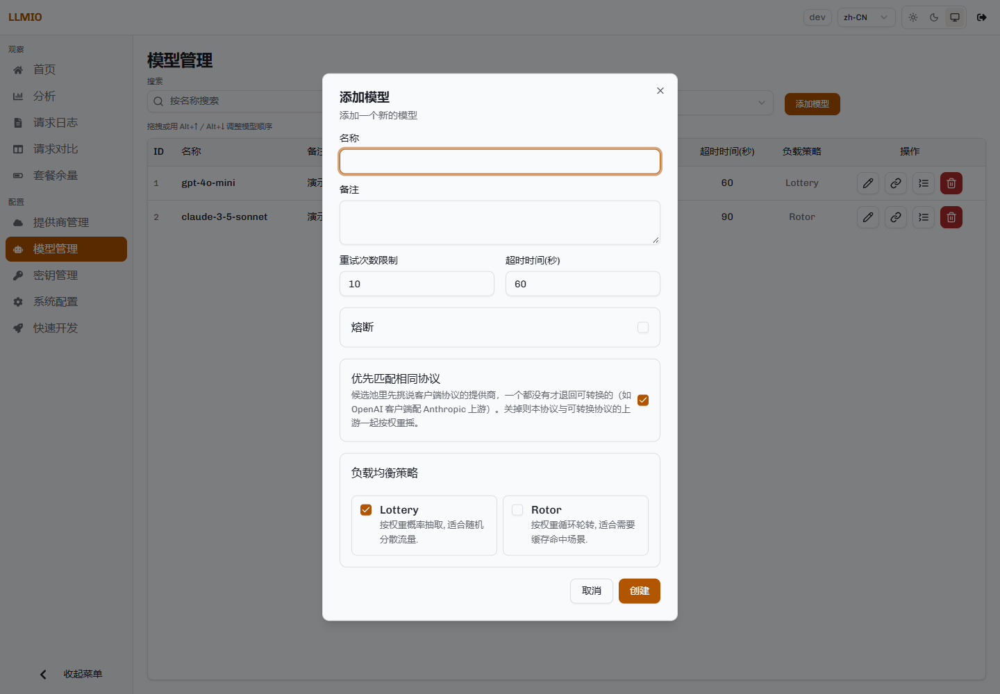
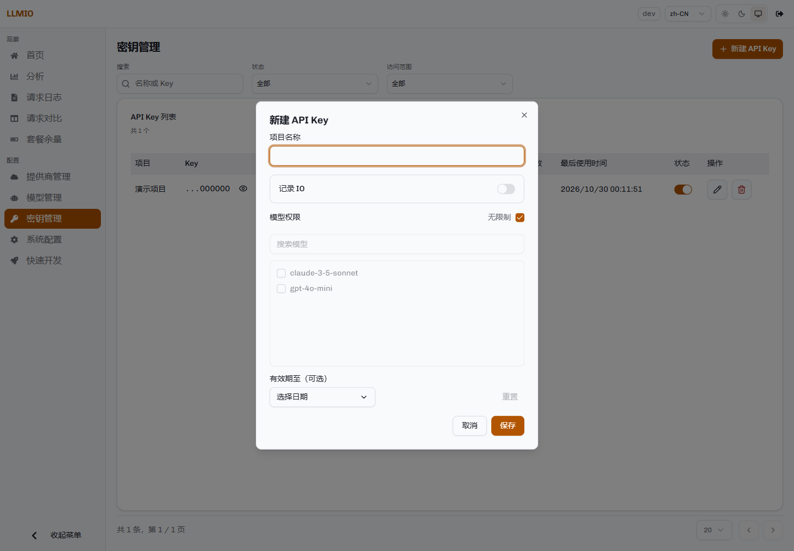

# 快速开始

本页从一台空机器开始，完成以下步骤：

1. 启动 LLMIO。
2. 登录控制台。
3. 添加一个提供商。
4. 添加一个模型。
5. 把模型关联到提供商。
6. 创建访问密钥。
7. 发送第一次请求。
8. 在控制台查看记录。

示例使用 Docker Compose。其他部署方式见[部署](Deployment)。

## 准备条件

- 一台可以运行 Docker 的机器。
- 一个可用的上游 API Key。
- 一个用于登录控制台的令牌。下文用 `<TOKEN>` 表示。

## 1. 启动服务

创建目录：

```bash
mkdir -p llmio && cd llmio
```

创建 `docker-compose.yml`：

```yaml
services:
  llmio:
    image: atopos31/llmio:latest
    container_name: llmio
    ports:
      - "7070:7070"
    volumes:
      - ./db:/app/db
    environment:
      - GIN_MODE=release
      - TOKEN=<TOKEN>
      - TZ=Asia/Shanghai
    restart: unless-stopped
```

启动：

```bash
docker compose up -d
```

检查服务是否正常。`/api/version` 需要携带令牌：

```bash
curl -H "Authorization: Bearer <TOKEN>" http://localhost:7070/api/version
```

正常时返回类似：

```json
{"code":200,"message":"success","data":"v0.10.2"}
```

数据保存在当前目录的 `./db`。删除容器不会删除数据；删除这个目录会删除配置和日志。

## 2. 登录控制台

浏览器打开：

```text
http://localhost:7070
```

输入 `TOKEN` 登录。


控制台左侧是页面导航。第一次使用时只需要「提供商管理」「模型管理」「密钥管理」三个页面。

## 3. 添加提供商

进入「提供商管理」，点击「添加提供商」。


填写：

| 字段 | 说明 |
|---|---|
| 名称 | 自定义名称，例如 `OpenAI 主账号`。只用于展示。 |
| 类型 | `openai`、`openai-res`、`anthropic`、`gemini` 四选一。 |
| `base_url` | 上游 API 根地址。不要以 `/` 结尾。 |
| `api_key` | 上游密钥。 |
| HTTP 代理 | 可选。需要经代理访问上游时填写。 |
| 响应体错误识别 | 可选。用于「HTTP 200 但响应体是错误」的渠道。每行一个样本，命中任意一个即视为失败。 |
| 控制台地址 | 可选。填写后，列表中的控制台按钮会打开这个地址。 |

常见类型的 `base_url`：

| 类型 | 示例 |
|---|---|
| `openai` | `https://api.openai.com/v1` |
| `openai-res` | `https://api.openai.com/v1` |
| `anthropic` | `https://api.anthropic.com/v1` |
| `gemini` | `https://generativelanguage.googleapis.com/v1beta` |

Anthropic 类型还需要填写 `version`，通常为 `2023-06-01`。

创建后可以在提供商列表查看上游模型列表。完整的连通性测试在关联保存后进行：进入模型的关联页，点击该关联的「测试」按钮。

## 4. 添加模型

进入「模型管理」，点击「添加模型」。



| 字段 | 说明 |
|---|---|
| 名称 | 客户端请求中使用的模型名，例如 `gpt-4o-mini`。这是 LLMIO 的请求名，不要求与上游模型名相同。 |
| 备注 | 可选。 |
| 重试次数限制 | 一次请求最多尝试多少次。包含第一次尝试，不是「失败后再重试几次」。 |
| 超时时间（秒） | 一次请求的总时间预算。流式请求的响应头等待时间取该值的三分之一。 |
| 熔断 | 是否启用熔断。默认关闭。 |
| 优先匹配相同协议 | 默认开启。开启后，只要该模型下有与客户端同协议的提供商，就只在这些提供商中选择；没有同协议提供商时才使用可互转的协议。 |
| 负载均衡策略 | `Lottery` 按权重随机；`Rotor` 按权重排序并固定使用队首。 |

新建时表单默认重试 10 次、超时 60 秒。实际值按上游情况调整。

## 5. 添加关联

在模型列表中找到刚创建的模型，点击「搜索」图标进入关联页，再点击「添加关联」。


| 字段 | 说明 |
|---|---|
| 提供商 | 选择第 3 步创建的提供商。 |
| 提供商模型 | 实际发给上游的模型 ID，例如 `gpt-4o-mini`。可以从下拉列表选择，也可以直接输入。 |
| 权重 | 大于 0。同一模型下多个关联按权重参与调度。 |
| 模型能力 | 工具调用、结构化输出、视觉。只有请求需要某项能力时，才会选择勾选了该项的关联。 |
| 请求头透传 | 是否把客户端的原始请求头带到上游。鉴权头与 `Accept-Encoding` 始终会被移除。 |
| 自定义请求头 | 可选。值支持占位符，见[提供商与模型](Providers-and-Models#请求头透传与自定义请求头)。 |
| 额外请求体参数 | 可选。JSON 对象，会合并进发往该上游的请求体，并覆盖同名参数。 |
| 计费配置 | 每百万 Token 的输入、缓存命中、输出单价，以及币种。留空表示不计算费用。 |
| 备用关联 | 开启后不参与日常轮询，只有主关联在本请求内全部失败后才接管。 |
| 峰谷计费 | 可选。给这条关联配置分时段价格系数，见[峰谷计费](Peak-Billing)。 |

一个模型可以添加多个关联，形成「一个请求名对应多家上游」的候选池。

## 6. 创建访问密钥

进入「密钥管理」，点击「新建 API Key」。



| 字段 | 说明 |
|---|---|
| 项目名称 | 用于区分调用方，例如 `测试项目`。 |
| 记录 IO | 开启后，成功的请求会保存请求体和响应体。默认关闭。 |
| 模型权限 | 「无限制」允许使用全部模型；关闭后勾选允许的模型。 |
| 有效期至 | 可选。留空表示永久有效。 |

保存后页面会显示完整 Key，格式为 `sk-llmio-` 加 36 个字符。可以在列表中查看或复制；如果 Key 泄露，删除后重新创建。

也可以跳过这一步，直接使用 `TOKEN` 调用。`TOKEN` 是管理员令牌，拥有全部模型权限。

## 7. 发送第一次请求

使用刚创建的 Key，请求中的 `model` 填第 4 步创建的请求名：

```bash
curl http://localhost:7070/openai/v1/chat/completions \
  -H "Authorization: Bearer sk-llmio-xxxxxxxx" \
  -H "Content-Type: application/json" \
  -d '{
    "model": "gpt-4o-mini",
    "messages": [
      {"role": "user", "content": "你好，请用一句话介绍你自己。"}
    ]
  }'
```

流式请求在请求体中加入 `"stream": true`。网关会原样转发 SSE 响应。

也可以使用控制台的「快速开发」页生成调用代码：


页面可以选择 API 格式、模型、密钥、流式开关，并生成 curl、TypeScript 或 Python 示例。

## 8. 查看结果

打开「请求日志」，最新一条记录对应刚才的请求。


记录中包含请求名、状态、Token、耗时、上游模型与提供商。点击行尾的详情按钮可以查看：

- TraceID、Session ID、远端 IP、User-Agent。
- 代理耗时、首包耗时、完成耗时、TPS。
- 输入、缓存、输出 Token。
- 输入、缓存、输出价格与总费用。
- 协议互转时的上游协议与转换说明。

开启「记录 IO」的请求可以在详情中点击「查看请求内容」，查看结构化后的请求和响应。

## 第一次请求失败的常见原因

| 现象 | 原因 | 处理 |
|---|---|---|
| `401 Invalid token` | Key 错误、已停用或已过期。 | 在「密钥管理」中检查状态与有效期。 |
| `not found model xxx` | 请求名与「模型管理」中的名称不一致。 | 使用模型列表里的名称。 |
| `not provider for model xxx` | 模型没有关联，或关联被停用。 | 在关联页启用至少一条关联。 |
| 上游返回 `400` | 参数或模型 ID 不被上游接受。 | 查看日志详情中的上游错误原文，检查提供商模型名与上游文档。 |
| 上游返回 `429` | 上游限流。 | 增加更多关联，或降低请求速率。网关会降低该关联的调度权重。 |
| 全部尝试失败 | 关联都不可用，或重试次数用尽。 | 查看日志中的最后一次错误。 |

更多排查方法见[故障排查](Troubleshooting)。
