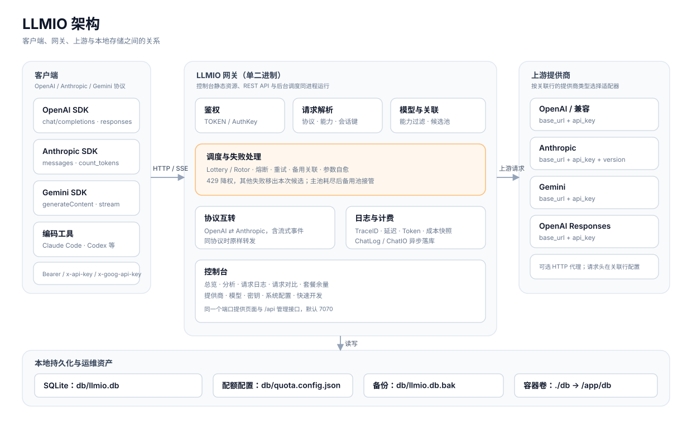

# LLMIO Wiki

LLMIO 是一个用 Go 编写的 LLM 网关。它在客户端和上游模型服务之间提供统一的 REST API、按权重分配请求、失败重试、协议互转、用量记录和管理界面。

客户端可以使用 OpenAI、Anthropic 或 Gemini 中任意一种协议接入。上游可以是 OpenAI、Anthropic、Gemini、OpenAI Responses，也可以是兼容其中一种协议的第三方服务。网关负责把请求送到合适的模型与提供商，并把结果、耗时、Token 和费用写入本地 SQLite。

## 适合哪些场景

- 一家上游不够用，需要在多家提供商之间分配请求。
- 不同客户端使用不同协议，但希望共用同一批上游。
- 需要按密钥限制可用模型，并统计每个项目、模型、提供商的用量。
- 需要查看每次请求的 TraceID、首包耗时、Token、缓存命中与费用。
- 需要在不依赖外部数据库的情况下部署一个单二进制服务。

## 文档导航

| 目标 | 页面 |
|---|---|
| 从零启动并完成第一次请求 | [快速开始](Getting-Started) |
| Docker、二进制、反向代理、升级与备份 | [部署](Deployment) |
| 理解提供商、模型、关联、密钥与日志的关系 | [核心概念](Core-Concepts) |
| 添加提供商与模型，配置能力、权重与价格 | [提供商与模型](Providers-and-Models) |
| 了解调度、重试、熔断、备用关联与参数自愈 | [调度与可靠性](Routing-and-Reliability) |
| 让 OpenAI 客户端访问 Anthropic 上游，或反向 | [协议互转](Protocol-Bridge) |
| 查询端点、鉴权方式与 curl 示例 | [API 接入](API-Access) |
| 逐页了解控制台 | [控制台指南](Console-Guide) |
| 分析页面的指标口径与筛选方式 | [用量分析](Analytics) |
| 请求日志、会话对比、IO 记录与清理 | [日志与对比](Logs-and-Compare) |
| 配置余额与套餐余量数据源 | [套餐余量](Quota) |
| 配置分时段价格与工作日日历 | [峰谷计费](Peak-Billing) |
| 压缩历史正文、回收空间、重整数据库 | [数据库维护](Database-Maintenance) |
| 环境变量、系统配置卡片与策略配置 | [配置说明](Configuration) |
| 管理接口清单与请求示例 | [管理接口](Management-API) |
| 本地开发、测试与构建 | [开发与测试](Development) |
| 常见错误的定位与处理 | [故障排查](Troubleshooting) |
| 限制、边界与常见问题 | [常见问题](FAQ) |

## 阅读顺序

第一次使用按以下顺序阅读：

1. [快速开始](Getting-Started)：启动服务，完成登录、配置和第一次请求。
2. [核心概念](Core-Concepts)：理解四个配置对象之间的关系。
3. [提供商与模型](Providers-and-Models)：按自己的上游填写配置。
4. [API 接入](API-Access)：把客户端指向网关。

已经部署过、只想查参数时，可以直接看 [配置说明](Configuration) 和 [管理接口](Management-API)。

## 版本说明

本文档对应 `upstream/master` 的提交 `0977d09`（2026-10-30），该提交包含 `v0.10.2` 之后的统计性能修复，是即将发布版本的基础。`v0.10.2` 已包含本文档描述的大部分功能；如果使用的版本更早，部分页面中的功能可能不存在。以仓库的 `README_cn.md`、`main.go` 和实际界面为准。

页面中的截图来自 `master` 的开发构建，版本标识可能显示为 `dev`；发布版会显示具体版本号。界面布局与字段一致。截图中的提供商、模型与请求为演示或测试数据，不对应真实账号。

## 相关链接

- 上游仓库：<https://github.com/atopos31/llmio>
- 发布包：<https://github.com/atopos31/llmio/releases>
- 问题反馈：<https://github.com/atopos31/llmio/issues>
- 许可证：MIT
