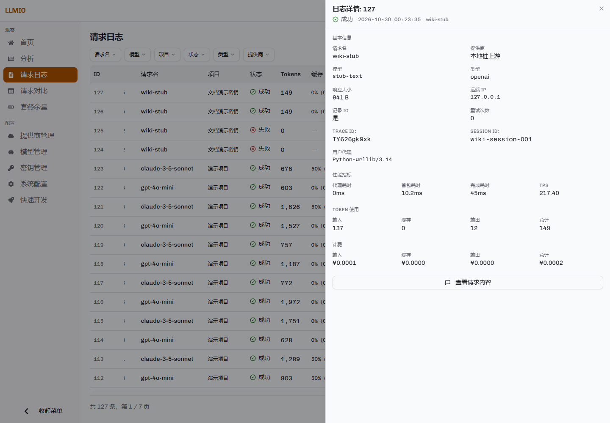
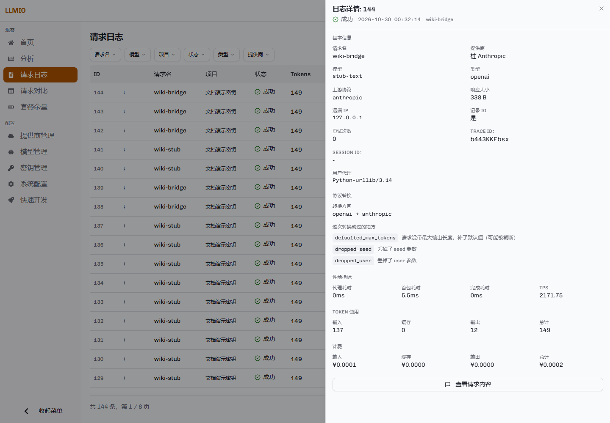
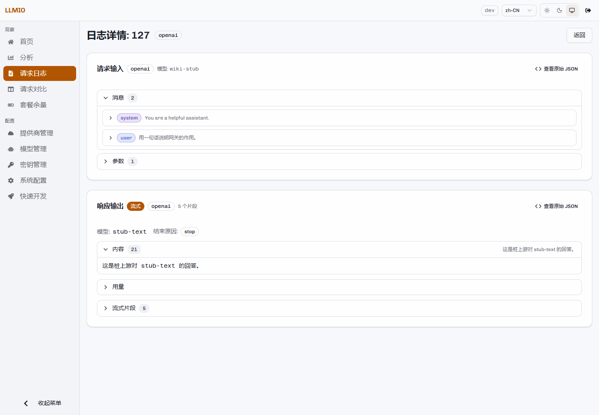

# 日志与对比

请求日志记录每次上游尝试的结果。请求对比用于分析多条请求的缓存前缀与分叉点。


## 日志列表

默认按 ID 倒序排列，最新的请求在最前。

### 筛选

页面顶部的筛选器：

| 筛选项 | 匹配对象 |
|---|---|
| 请求名 | 客户端请求体中的 `model`。 |
| 模型 | 实际发给上游的模型 ID（`provider_model`）。 |
| 项目 | 发起请求的 AuthKey 名称。 |
| 状态 | 成功、运行中、错误。 |
| 类型 | 客户端协议：OpenAI、Anthropic、Gemini、OpenAI Responses。 |
| 提供商 | 上游提供商名称。 |

搜索框：

- ID：精确匹配日志 ID。
- TraceID：精确匹配。
- Session ID：精确匹配。

前六个筛选维度支持多选。选择多个值时，命中任意一个即显示。

### 列

默认列包括 ID、时间、请求名、项目、状态、Token、缓存、响应大小、耗时、模型、类型、提供商。可以通过列设置显示或隐藏其他列：

- TraceID
- Session ID
- TPS
- 成本
- 重试
- 远端 IP
- User-Agent
- 上游协议
- 桥接说明

### 多行记录

一次客户端请求可能产生多条日志：

- 每次失败的尝试各写一条错误记录。
- 最终成功或最终失败再写一条正式记录。

这些记录的 TraceID 相同。排查时先按 TraceID 搜索，再按时间顺序查看每次尝试。

进程启动时，上一次运行遗留的「运行中」记录会被收尾为错误，避免页面永远显示在途请求。

## 日志详情

点击行尾的详情按钮打开侧边面板。



### 基本信息

请求名、提供商、模型、类型、响应大小、远端 IP、记录 IO、重试次数、User-Agent、TraceID、Session ID。

### 性能指标

| 指标 | 含义 |
|---|---|
| 代理耗时 | 请求进入网关到准备发往上游的耗时，包含鉴权、解析与查询关联。 |
| 首包耗时 | 从请求开始到读取到上游第一个响应片段的耗时。 |
| 完成耗时 | 首包之后到响应结束的耗时。 |
| TPS | 输出 Token ÷ 请求总耗时（秒）。 |

### Token 与计费

Token 使用分为输入、缓存、输出、总计。计费分为输入、缓存、输出与总计，使用请求发生时的价格快照。

### 协议转换

当客户端协议与上游协议不同时，详情中显示：

- 上游协议。
- 转换方向。
- 本次转换的短码与说明。



例如 `defaulted_max_tokens` 表示补了最大输出长度，`dropped_seed` 表示丢掉了 `seed`。

## 请求内容

### IO 记录开关

请求正文是否保存，由调用方使用的 AuthKey 决定：

- AuthKey 开启「记录 IO」：请求保存请求体；成功的请求还保存响应体。
- AuthKey 关闭「记录 IO」：只保存日志元数据。
- 直接使用 `TOKEN` 调用：不记录 IO。`TOKEN` 没有对应的 AuthKey 配置。

失败的尝试可能保存请求体，但不会保存响应体。

### 查看方式

在日志详情底部点击「查看请求内容」。



成功请求会保存请求体和响应体。失败的尝试也可能保存请求体，但没有响应体；是否出现取决于该次尝试是否走到写 IO 的路径。

页面按客户端协议解析请求：

- 请求输入：消息、工具、参数、系统提示、生成配置等。
- 响应输出：内容、用量、结束原因、工具调用、流式片段。
- 可以展开原始 JSON。
- 流式响应会显示片段数量，并能展开每个片段。

如果请求没有 IO 记录，页面会提示「未找到会话记录，IO 记录可能未启用」。

### 存储

请求正文按内容分块压缩后存储。读取接口会透明还原，因此页面看到的是原始 JSON。压缩与空间回收见[数据库维护](Database-Maintenance)。

## 请求对比

在日志列表勾选最多 6 条记录，点击「对比」。


### 公共前缀

对比页按缓存的实际渲染顺序计算公共前缀：

```text
工具 → 系统提示 → 消息
```

这意味着：

- 工具定义变化会使后面的系统提示与消息全部无法复用缓存。
- 系统提示变化会使消息部分无法复用。
- 消息中任意一处变化会使后面的内容无法复用。

页面显示：

- 公共前缀条目数。
- 其中工具、系统提示、消息各占多少。
- 每条请求从第几项开始分叉。
- 完整包含公共前缀的请求。

### 内容缺失

前缀分析只基于有请求内容的记录。未开启 IO、失败或已被清理的记录没有正文，页面会显示「有 N 条中 M 条缺少请求内容」。缺少内容的请求无法参与精确的前缀比较。

### 适用场景

- 多个客户端请求相似但不完全相同，想确认缓存为什么没有命中。
- 同一个请求名走了不同提供商，想比较请求体差异。
- 调整系统提示或工具定义后，想确认前缀从哪一项开始变化。

## 清理日志

### 手动清理

日志页右上角的清理按钮支持两种方式：

- 保留最近 N 条。
- 保留最近 N 天。

清理会删除超出范围的日志记录。操作不可撤销。

### 定时清理

「系统配置」→「日志定时清理」可以设置：

- 是否启用自动清理。
- 保留天数。

后台每小时检查一次。定时清理与手动清理的执行记录可以在「查看清理历史」中查询。

### 保留策略建议

- 只关心近期问题时，保留 7–30 天。
- 需要长期分析用量时，保留更长时间，并开启数据库压缩。
- 开启 IO 记录会显著增加磁盘占用；不需要正文时关闭。
- 清理后数据库文件不会自动缩小，需要空间回收或重整，见[数据库维护](Database-Maintenance)。

## 相关接口

| 路径 | 方法 | 功能 |
|---|---|---|
| `/api/logs` | GET | 日志列表与筛选。 |
| `/api/logs/:id/chat-io` | GET | 读取单条日志的请求与响应正文。 |
| `/api/logs/cleanup` | POST | 手动清理。 |
| `/api/logs/cleanup/history` | GET | 清理历史。 |
| `/api/user-agents` | GET | User-Agent 去重列表。 |
| `/api/provider-models` | GET | 上游模型名去重列表。 |

参数与返回结构见[管理接口](Management-API#日志)。
