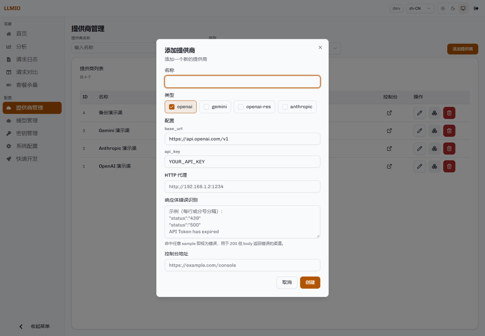
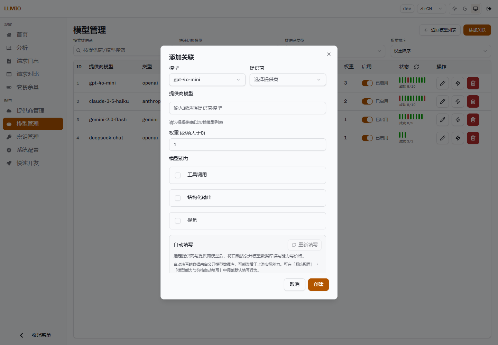

# 提供商与模型

本页说明如何配置上游、模型和两者之间的关联。


## 提供商

提供商保存上游的类型、地址、密钥和可选的网络配置。一个提供商可以被多个模型复用。

### 类型与请求路径

| 类型 | 聊天请求路径 | 模型列表路径 | 配置字段 |
|---|---|---|---|
| `openai` | `{base_url}/chat/completions` | `{base_url}/models` | `base_url`、`api_key` |
| `openai-res` | `{base_url}/responses` | `{base_url}/models` | `base_url`、`api_key` |
| `anthropic` | `{base_url}/messages` | `{base_url}/models` | `base_url`、`api_key`、`version` |
| `gemini` | `{base_url}/models/{model}:generateContent`；流式为 `:streamGenerateContent?alt=sse` | `{base_url}/models` | `base_url`、`api_key` |

`base_url` 是 API 根地址。填写时不要以 `/` 结尾，否则会拼出双斜杠。常见值：

| 类型 | `base_url` |
|---|---|
| `openai` | `https://api.openai.com/v1` |
| `openai-res` | `https://api.openai.com/v1` |
| `anthropic` | `https://api.anthropic.com/v1` |
| `gemini` | `https://generativelanguage.googleapis.com/v1beta` |

`openai` 与 `openai-res` 是两个不同的上游类型。`openai` 走 Chat Completions，`openai-res` 走 Responses API。它们不能互相替代。

### 添加提供商



步骤：

1. 进入「提供商管理」。
2. 点击「添加提供商」。
3. 填写名称。
4. 选择类型。
5. 填写 `base_url` 与 `api_key`，Anthropic 再填写 `version`。
6. 按需填写 HTTP 代理、响应体错误识别、控制台地址。
7. 点击「创建」。

列表中的节点图标用于查看该提供商返回的模型列表，不发送聊天请求。真正的连通性测试在关联页进行：保存关联后，点击该关联的「测试」按钮。测试失败时先检查 `base_url`、密钥和网络。

### HTTP 代理

代理字段接受 HTTP 代理地址，例如：

```text
http://192.168.1.2:1234
```

代理只作用于该提供商的请求，包括聊天请求和模型列表请求。不需要代理时留空。

### 响应体错误识别

有的上游在限流、欠费或内部错误时仍返回 HTTP 200，但响应体是错误对象。这个字段用于识别这种情况。

规则：

- 每行一个样本，也可以用分号分隔。
- 返回体包含任意一个样本，就按失败处理。
- 失败后走正常的重试与换家流程。

示例：

```text
"status":"439"
"status":"500"
API Token has expired
```

流式响应不会被提前读取，因此这个检查只对非流式响应生效。

### 控制台地址

填写后，提供商列表中的控制台按钮会打开这个地址。它只是链接，不影响请求。

## 模型

模型表示客户端请求时使用的名称。请求体里的 `model` 必须与这里配置的名称一致。


| 字段 | 说明 | 表单默认值 |
|---|---|---|
| 名称 | 客户端请求名。 | 无 |
| 备注 | 可选说明。 | 无 |
| 重试次数限制 | 一次请求最多尝试多少次，包含第一次。 | 10 |
| 超时时间（秒） | 总时间预算。流式请求的响应头等待时间为该值的三分之一。 | 60 |
| 熔断 | 是否启用熔断包装。 | 关闭 |
| 优先匹配相同协议 | 是否优先选择与客户端同协议的提供商。 | 开启 |
| 负载均衡策略 | `Lottery` 或 `Rotor`。 | `Lottery` |

通过管理 API 创建模型时，`max_retry` 和 `time_out` 必须显式给出大于 0 的值。省略时它们是 0，请求不会尝试任何一次。

### 负载策略

- `Lottery`：按权重概率抽取。权重越大，被选中的概率越高。适合把流量分散到多家上游。
- `Rotor`：按权重从大到小排序，每次取队首。成功时队首保持不动；收到 429 时移到队尾；其他失败从队列删除。

当前实现中，`Rotor` 在成功请求上不会主动轮转。只要队首关联持续成功，请求就会一直落在它上面。因此它更接近「按权重排序的优先级」，而不是按比例轮转。需要按权重分散流量时请使用 `Lottery`。

界面的策略说明写作「循环轮转」；当前实现只在 429 时把队首移到队尾，本文按实际行为描述。

两种策略都支持熔断包装。详细行为见[调度与可靠性](Routing-and-Reliability)。

### 优先匹配相同协议

开启时：

- 如果该模型下存在与客户端协议相同的提供商，候选池只包含这些提供商。
- 只有完全没有同协议提供商时，才使用可互转的协议。

关闭时：

- 本协议与可互转协议的提供商一起按权重参与。

默认开启。关闭适用于「同协议上游都不稳定，宁可把流量分给另一协议」的场景。

## 关联

关联把模型映射到提供商的某个具体模型。


进入方式：在模型列表点击「搜索」图标，进入该模型的关联页，再点击「添加关联」。



### 提供商模型

这是实际发给上游的 `model` 值。可以手动输入，也可以从提供商模型列表选择。

例如：

- 请求名：`gpt-4o-mini`
- 提供商模型：`gpt-4o-mini-2024-07-18`

客户端只看到请求名，LLMIO 在转发时替换为提供商模型。

### 模型能力

| 能力 | 触发条件 |
|---|---|
| 工具调用 | 请求体包含非空 `tools`，或 Gemini 的 `tools` / `toolConfig` / 函数调用内容。 |
| 结构化输出 | OpenAI 的 `response_format`、Responses 的 `text.format.type=json_schema`、Gemini 的 `responseJsonSchema` 或 `responseMimeType=application/json`。Anthropic 解析器在请求包含 `tools` 时也会把结构化输出置位，因此 Anthropic 客户端的工具请求需要同时勾选「工具调用」与「结构化输出」。 |
| 视觉 | 用户消息中包含图片（OpenAI `image_url`、Responses `input_image`、Anthropic `image` 块、Gemini `inlineData` / `fileData` 且 MIME 为图片）。 |

只有请求需要某项能力时，LLMIO 才会把勾选了该项的关联放进候选池。能力判断由请求内容自动完成，不需要客户端额外声明。

### 权重

权重必须大于 0。同一模型下多条关联按权重参与调度。

- `Lottery`：权重是概率比例。
- `Rotor`：权重决定初始排序；成功时保持队首，429 时移到队尾，其他失败删除。

权重不要求总和为固定值。例如 3:2:1 与 30:20:10 的效果相同。

### 请求头透传与自定义请求头

「请求头透传」开启时，客户端请求头会被复制到上游请求。以下请求头始终会被删除：

- `Authorization`
- `X-Api-Key`
- `X-Goog-Api-Key`
- `Accept-Encoding`

前三个是避免把客户端的网关凭据泄露给上游。`Accept-Encoding` 必须留给 Go 的传输层处理，否则上游返回的压缩响应不会被透明解压，日志中的响应体会变成乱码。

自定义请求头的值支持占位符：

| 占位符 | 值 |
|---|---|
| `{{session}}` | 会话键。按请求体 `session_id` → 入站会话头 → 对话根哈希 → 随机串的顺序派生，保证非空。 |
| `{{session_id}}` | 仅请求体中显式传入的 `session_id`。 |
| `{{model}}` | 客户端请求名。 |
| `{{provider_model}}` | 关联里的提供商模型名。 |
| `{{trace_id}}` | 本次请求的 TraceID。 |
| `{{auth_key_id}}` | 调用方 AuthKey 的 ID。 |
| `{{uuid}}` | 每次求值生成一个新的随机串。 |

未识别的占位符保持原样，便于发现拼写错误。已识别的占位符求值结果为空时，用随机串填充，保证请求头非空。

请求头优先级：

```text
提供商自身配置 > 自定义请求头 > 透传的客户端请求头
```

提供商适配器最后写入自己的鉴权头，因此即使自定义请求头里写了同名头，也不会覆盖上游密钥。

### 额外请求体参数

「额外请求体参数」是一个 JSON 对象。LLMIO 会把它合并进发往该上游的请求体，并覆盖客户端请求中的同名参数。

示例：

```json
{
  "chat_template_kwargs": {
    "enable_thinking": false
  }
}
```

合并发生在协议互转之后。因此这些参数应按上游协议书写，而不是按客户端协议书写。

### 计费配置

三档价格均为「每百万 Token」的单价：

| 字段 | 含义 |
|---|---|
| 输入价格 | 非缓存输入 Token 的单价。 |
| 缓存命中价格 | 命中缓存的输入 Token 的单价。 |
| 输出价格 | 输出 Token 的单价。 |
| 货币 | 展示用币种，例如 `CNY` 或 `USD`。 |

留空或为 0 时，该档费用按 0 计算。价格保存在关联上，因为同一模型在不同上游的价格可能不同。

请求发生时，LLMIO 把当时生效的三档价格写入日志。之后修改价格不会改写历史费用。

### 备用关联

开启后，这条关联不参与日常轮询。只有当主关联在本请求内全部失败并被移出候选池后，备用池才会接管。

备用池的行为：

- 只在主池清空后启用。
- 接管后不会切回主池。
- 日志的 `Backup` 字段会标记本次响应由备用关联提供。

备用关联用于主池全部失败后的接管。请确保模型的重试次数足够覆盖主池与备用池的尝试。

### 启用状态

每条关联可以单独启用或停用。停用后不参与候选池，但配置保留。

## 模型能力与价格自动填写

在创建或编辑关联时，表单可以根据提供商与提供商模型，从公开模型数据库预填能力与价格。

默认行为：

- 启用自动填写。
- 只补空值，不覆盖已经填写的值。
- 不提供已废弃模型的建议。
- 数据源按顺序尝试 `models.dev`、`litellm`。

可以在「系统配置」→「模型能力与价格自动填写」中修改这些行为。自动填写只影响弹窗里的表单，保存前可以逐项修改；保存路径不会在服务端补值。

数据源可能滞后于上游实际能力。自动填写结果仅作为默认值，最终以实际测试为准。

## 模型测试

关联列表中的「测试」按钮提供两类测试：

- 连通性测试：使用该关联的提供商、提供商模型、自定义请求头与代理发送一次最简单的请求，确认地址、密钥和模型可用。
- React Agent 能力测试：发送带工具调用的多轮请求，检查模型的工具调用与响应能力。该测试仅支持 `openai` 类型。

测试结果会显示成功或失败原因。测试不会修改关联配置。

## 常见配置错误

| 现象 | 检查 |
|---|---|
| 关联测试失败 | `base_url` 是否包含正确的版本路径；密钥是否有效；服务器能否访问上游。 |
| 请求返回 `model not found` | 请求名是否与模型名称一致；关联是否启用。 |
| 请求返回上游 400 | 提供商模型 ID 是否正确；上游是否支持请求中的参数。 |
| 工具调用请求没有候选 | 至少一条启用的关联勾选了「工具调用」。 |
| 图片请求没有候选 | 至少一条启用的关联勾选了「视觉」。 |
| 结构化输出请求没有候选 | 至少一条启用的关联勾选了「结构化输出」。 |
| 请求总是落到同一家 | `Rotor` 成功时不轮转，会固定使用队首；需要分散流量请改用 `Lottery`。 |
