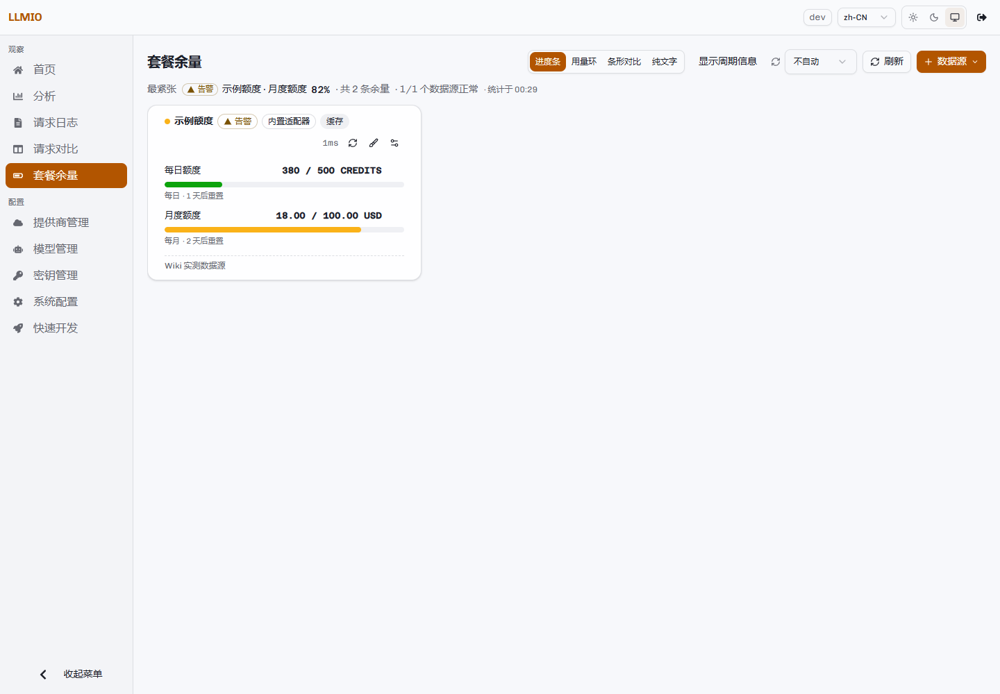

# 套餐余量

「套餐余量」把不同上游的余额、套餐额度与重置时间归一到同一张页面。它只做展示，不参与聊天请求的调度，也不会因为余额不足自动停用提供商。



## 数据源类型

| 类型 | 适用场景 |
|---|---|
| 内置适配器 | 已实现解析逻辑的官方接口。多数只需要填接口地址与 API Key。 |
| HTTP | 任意返回 JSON 的接口。自己配置地址、鉴权、取数组路径与字段映射。 |
| 脚本 | 需要多步登录、计算或拼接结果的接口。在沙箱里执行一段 JavaScript。 |

### 内置适配器

| ID | 说明 |
|---|---|
| `deepseek` | DeepSeek 余额。读取 `/user/balance`。 |
| `moonshot` | Moonshot / Kimi 余额。读取 `/users/me/balance`。 |
| `scnet` | 国家超算 TokenPlan。登录型，需要 `SCNET_USER` 与 `SCNET_PASS`。 |
| `opencode` | opencode.ai 套餐。登录型，需要 `OPENCODE_COOKIE` 与 `OPENCODE_ORG_ID`。 |
| `commandcode` | Command Code 套餐。一次刷新请求额度与订阅两个端点，给出 5 小时、每周、每月三档。 |
| `custom` | 通用端点。必须填写请求路径，并用 `itemsPath` 与 `map` 取数。 |

部分内置适配器在界面上标记为「未实测」。第一次配置时先点「试跑」，确认返回结构符合预期。

## 配置文件

配额配置默认保存在：

```text
./db/quota.config.json
```

可以用环境变量 `LLMIO_QUOTA_CONFIG` 修改路径。

特性：

- 文件权限为 `0600`。
- 写入是原子的。
- 凭据不落 SQLite。
- 接口返回配置时自动脱敏；保存时按掩码还原为已存值。
- 试跑不会保存配置，也不会写缓存。

## 取数与缓存

- 服务端没有后台定时刷新线程。只有收到页面或接口请求时才向上游取数。
- 结果按数据源缓存，TTL 为全局刷新周期，最小 10 秒。
- 只缓存成功的结果；失败不写缓存。
- 页面自动刷新是独立的一层，档位 0–600 秒，默认关闭。
- 页面不可见时不请求上游；回到前台立即补一轮。
- 单次刷新可以只跑指定数据源，或忽略缓存强制刷新。

## 状态与阈值

每个条目可以给出「已用」「总量」「剩余」中的任意两个，剩余值可以推算出第三个。

| 状态 | 条件 |
|---|---|
| 充足 | 使用率低于告警阈值。 |
| 告警 | 使用率达到阈值，但未用尽。 |
| 已用尽 | 剩余为 0，或使用率达到 100%。 |
| 未知 | 数据不足，无法计算比例或状态。 |

全局默认告警阈值为 80%。每个数据源可以单独覆盖。

页面顶部会把最紧张的一条上浮为摘要，并显示正常数据源数量、失败数量、条目总数与统计时间。

## 使用流程

1. 进入「套餐余量」。
2. 点击「数据源」→「手动添加」。
3. 选择类型，填写名称、ID、启用状态。
4. 按类型填写接口与凭据。
5. 点击「试跑（不保存）」。
6. 确认解析出的条目与数值正确。
7. 保存。
8. 点击「刷新」或开启自动刷新。

试跑结果会显示耗时、解析出的条目数、原始产出、退出码、STDOUT 与 STDERR，便于排查脚本或字段映射。

## HTTP 数据源

| 字段 | 说明 |
|---|---|
| 请求地址 | 完整 URL。 |
| 方法 | `GET` 或 `POST`。 |
| 查询参数 | 附加在 URL 后，多个参数用 `&` 连接。 |
| 请求头 | 一行一条，写成 `名字=值`。 |
| 鉴权 | `bearer`、`header`、`basic`、`none`。 |
| 请求体 | POST 时发送的 JSON。 |
| 取数组路径 | 指向数组的 JSON 路径，例如 `data.items`。 |
| 字段映射 | 每行「目标字段=响应字段路径」。 |
| 固定字段 | 每行「字段=值」，用于补充响应里没有的常量。 |
| 超时 | 秒。留空使用默认值。 |

字段映射支持的目标字段：

```text
id、label、used、total、remaining、unit、window、
resetAt、expireAt、status、format
```

值以 `=` 开头表示字面量，例如：

```text
unit==CREDITS
```

请求头和查询参数支持占位符：

```text
{{apiKey}}、{{baseUrl}}、{{id}}、{{name}}
```

### 示例

接口返回：

```json
{
  "data": {
    "items": [
      {"name": "每日额度", "used": 120, "total": 500, "unit": "CREDITS", "window": "day"}
    ]
  }
}
```

数据源配置：

| 字段 | 值 |
|---|---|
| 类型 | `builtin` |
| 内置适配器 | `custom` |
| 接口地址 | `https://example.com` |
| 请求路径 | `/usage` |
| 取数组路径 | `data.items` |
| 字段映射 | `label=name`、`used=used`、`total=total`、`unit=unit`、`window=window` |
| 告警阈值 | `80` |

## 脚本数据源

脚本在独立子进程中执行，语言为 JavaScript（goja，以 ES5.1 为基准）。

可用全局：

- `console`
- `output()`
- 该数据源自己的 `env` 白名单
- 显式开启后的 `fetch`

没有 `require`、文件系统与子进程。

`fetch` 默认关闭。开启后：

- 只允许 `http` / `https`。
- 拒绝 loopback 与内网地址。
- 逐跳重定向最多 5 次。

脚本没有堆上限，隔离依靠进程边界。脚本失控只影响子进程，超时后被杀，网关不受影响。默认超时 30 秒，可在数据源中覆盖。

脚本把结果传给 `output()`，或直接 `return`：

```javascript
const res = await fetch(env.API_URL + "/usage", {
  headers: { Authorization: "Bearer " + env.API_KEY }
});
const data = await res.json();
output({
  items: [
    { label: "月度额度", used: data.used, total: data.total, unit: "USD", window: "month" }
  ]
});
```

密钥放在 `env` 中，不要写死在脚本里。下发给前端时 `env` 会自动打码。

## 条目与展示

每个数据源可以设置：

- 显示名称、备注、图表样式。
- 条目显示格式，例如 `{remaining} / {total} {unit}`。
- 隐藏某个条目。隐藏只影响展示，数据仍会查询。
- 每个条目的图表样式；数据源样式为「跟随全局」或固定一档。

显示名、格式与图表样式保存在浏览器本地，不写服务端。换浏览器后会回到默认展示。

图表样式：

- 进度条
- 用量环
- 条形对比
- 纯文字

## 只读模式

设置：

```bash
LLMIO_QUOTA_ALLOW_WRITE=false
```

后：

- 读接口正常。
- 新增、修改、删除数据源返回 403。
- 页面隐藏编辑入口并显示只读提示。
- 试跑仍然可用，因为它不改变任何状态。

## 管理接口

| 路径 | 方法 | 功能 |
|---|---|---|
| `/api/quota/config` | GET | 读取配置、内置适配器清单、路径、只读状态、默认刷新周期与阈值。 |
| `/api/quota/config` | PUT | 修改刷新周期与告警阈值。 |
| `/api/quota/sources` | POST | 新增数据源。 |
| `/api/quota/sources` | PUT | 按 ID 更新数据源。 |
| `/api/quota/sources/:id` | DELETE | 删除数据源。 |
| `/api/quota/run` | POST | 拉取全部启用的数据源。 |
| `/api/quota/sources/:id/refresh` | POST | 强制刷新单个数据源。 |
| `/api/quota/test` | POST | 试跑一个未保存的数据源。 |

`/api/quota/run` 支持：

- `force=true`：忽略缓存。
- `ids=a,b`：只跑指定数据源。

## 安全建议

1. 配额配置文件包含上游凭据，按 0600 权限保存，并纳入备份范围。
2. 不要把真实凭据写入脚本源码，使用 `env`。
3. 只给需要外部请求的脚本开启 `fetch`。
4. 试跑会向上游发起真实请求；公开演示环境不要配置真实凭据。
5. 余额数据只用于展示，不要把它当成计费或风控的唯一依据。
